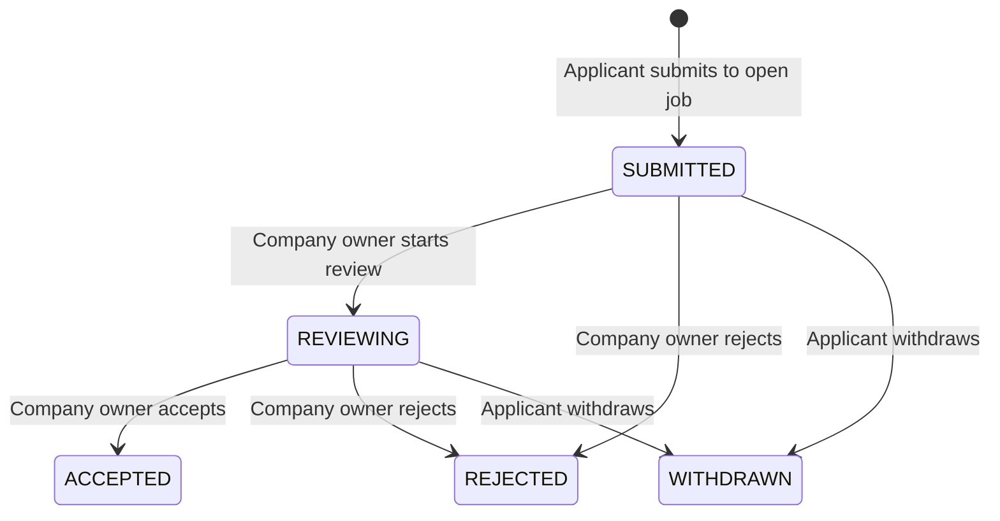

# Job applications

Current additions: [delegated recruiters](recruiting-slice.md), [optional plain-text resumes](resumes-slice.md), [versioned application questions](application-questions-slice.md) and [durable application notifications](notifications-slice.md) supersede the initial scope below. The remaining PDF/DOCX and S3 processing backlog is unchanged.

## Scope and requirements

| ID | Source classification | Implementation | Evidence/status |
|---|---|---|---|
| INT-APP-001 | Explicit: internal job application, persistence, duplicate prevention | Statement form, explicit disclosure, PUT /jobs/{jobId}/application, V23 | Integration verified |
| INT-APP-002 | Explicit: application tracking and status | /applications MINE view, live signals plus REST recovery | Browser journey |
| BE-APP-003 | Explicit: authorized recruiter actions and lifecycle | Company-owner review, expected versions, immutable terminal states, audit | Authorization/concurrency tests |
| INT-APP-004 | Inferred interaction: applicant withdrawal | Withdraw submitted/reviewing application, retain receipt | API/browser tests |
| BE-APP-005 | Explicit: sensitive-data authorization | Frozen name/headline snapshot and statement; applicant/owner-only reads | Isolation/snapshot tests |

The uploaded backend jobs requirements and frontend jobs requirements remain authoritative. This increment provides a working profile-based application path, not the required future resume-upload path. The form clearly states that resume uploads are unavailable. It discloses the exact shared fields and requires the member to confirm sharing before submission. A company page is still member-created and unverified. No external employer integration or employment-offer issuance is implied.

## Contracts and ownership

The existing Spring deployment owns job_application and application_audit in PostgreSQL (V23). The public contracts and generated TypeScript models are in the existing OpenAPI workflow. All endpoints require an authenticated OIDC session; mutations require CSRF. The applicant identity comes from the principal, and company review authority comes from the job's organization owner. Neither can be supplied by the browser.

Only the applicant and the owning company owner can read a record. RECEIVED never lists other companies' applications; MINE never lists other candidates. The UI cannot grant permission. Unauthorized status changes return 404 for outsiders, and 403 for a party attempting the other role's action. Personal profile visibility does not prevent this explicit application disclosure. Retained application records remain available to these authorized parties even after a personal block or a job closure; company ownership transfer is not implemented.

The name/headline snapshot is read from the authoritative profile at submission and stays unchanged when the profile changes. Email addresses, phone numbers, private profile sections and member identifiers are not part of the response. Statements remain plain text, bounded to 4,000 characters, and are rendered as text. Job title and company name are current values, not frozen job-description snapshots. Private content is never placed in the general Kafka or WebSocket stream.

## Transactions and lifecycle

The unique (job_id, applicant) constraint allows one application per member/job in this initial policy, including after withdrawal or rejection. Reapplication and statement editing remain pending. Exact normalized statement retries return the existing record, including its current terminal state, without another audit row or reactivation. A different statement returns 409. New applications require an initialized profile, an OPEN job and a member who is not that company's owner.

Submission locks the job row, serializing with job closure. If submission wins the lock, its application may commit before closure; if closure wins, the new application is rejected. The profile snapshot, application and submission audit row commit in one local transaction. Review/withdrawal lock the application row, validate actor/state/version, and commit a status update and audit row together. A stale write returns 409; the client must refresh rather than blindly retry.

ACCEPTED, REJECTED and WITHDRAWN are terminal in this slice. Accepted means an application-review outcome, not a signed employment offer. Audit rows store actor, previous/next status, version and timestamp with a unique application/version key. The authorized history endpoint described below now exposes transition roles and timestamps. Restricted database access and future retention controls still apply to full audit rows.

## Frontend and recovery

Job details provide a profile-based statement form and an existing-application receipt. Owners see a Review applications link instead of a self-application form. The Jobs sidebar links to My applications. The tracker supports applicant/received views, optional job filtering and twenty-row UUID cursor pages. Review actions appear only for permitted states, but server rules remain authoritative.

Mutations show success only after the backend confirms persisted data. A timed-out submission retains its statement so an explicit unchanged retry can retrieve the existing receipt. Dirty text warns before browser navigation. Statements are memory-only until submitted. Creation does not optimistically claim success. On session rejection, the active form/tracker clears sensitive data and disables writes.

After commit, the existing in-process WebSocket handler sends only its content-free refresh hint to the applicant and company owner. The tracker reloads authorized REST data on signals, reconnect and three-second polling, with failure backoff and ten-second request deadlines. Lost signals are recoverable; these are not durable application-notification events. Cross-replica fan-out, durable notification delivery and external email are not implemented for applications. Status mutations are never automatically retried. Polling is suspended during a local mutation; obsolete reads are cancelled before view/page changes.

## Remaining requirements

Secure resume/media storage and scanning, job-specific required questions, attachments, delegated recruiters, reapplication/statement correction, interview scheduling, recruiter notes, application notifications/alerts, exports/deletion/retention, moderation, dedicated SLOs/metrics and load testing remain pending. The required resume-based E2E-009 journey is still incomplete despite this verified narrower path. Company jobs and application data are local to this product; there is no connection to LinkedIn or an outside hiring system. No AWS deployment or production-readiness claim is made.

## Verification

Executed `./scripts/container-up.sh --profile observability` successfully with V23. `./scripts/verify.sh` passed 64 backend invocations (60 profile/domain integration, three WebSocket handler, one Kafka/outbox integration), generated OpenAPI consistency, strict TypeScript and all thirteen real-service browser journeys. Application tracker desktop/mobile axe and mobile overflow checks passed; both light-mode captures were visually reviewed. Application-specific dark-mode visual verification remains pending. These checks do not establish full WCAG conformance, production capacity or overall platform completion. Backend coverage includes private snapshots, authorization, exact retry/conflicting retry, audit counts, terminal states, 21-record pagination, eight concurrent identical submissions, concurrent review/withdrawal and closure/submission races. The real-service browser journey delays a genuine committed response past the client deadline, retries without duplication, follows live review/acceptance and withdrawal across two accounts, and revokes the candidate session. Fixtures use real local APIs, PostgreSQL and Keycloak; only email transport and deliberate network-failure injection are substituted.

## Application history and status filters

INT-APP-006 (explicit application tracking/audit requirements) adds an applicant/company-owner-only transition timeline. GET /applications/{id}/history checks ownership in the same SQL query that retrieves the audit rows. Unknown and unauthorized IDs both return 404. The response is no-store and includes the current application version plus chronological entries containing version, source/target status, actor role and timestamp. It excludes actor subject identifiers, profile data and statements.

A single SQL statement provides a consistent database snapshot of application version and committed audit history, even if review changes concurrently. The current acyclic state machine allows at most three entries: submission, optional review, terminal decision. History therefore needs no separate pagination in this lifecycle. Adding future reopening or more review stages requires revisiting the contract's three-entry bound. Duplicate submission retries and failed status transitions do not add entries.

The tracker lazily loads history when its disclosure opens. It refreshes an open timeline when the application version changes through live refresh/polling, clears stale timeline data while loading, supports explicit retry, and cancels in-flight reads when closed or unmounted. A session rejection clears the parent tracker. The timeline may observe a newer committed version before the list refresh completes; it labels that condition rather than pretending the summary is already current.

INT-APP-007 (explicit job tracking/filter requirements) adds an optional exact status filter to GET /applications and a corresponding selector. The server combines status with caller ownership, optional job ID and keyset cursor before taking a page. Changing the filter resets the cursor, cancels obsolete reads and clears prior results; the filter remains active across MINE/RECEIVED view changes. A full reload resets this transient filter to All statuses. No new migration is required.

Backend tests check anonymous/outsider denial, consistent version/order/role output, lack of identifiers and statement fields, duplicate/failed-transition history stability, and filtered pagination over 22 persisted applications. Browser coverage checks history updates during real review/acceptance, owner and applicant visibility, withdrawal history, selected/empty/all status filters, and session cleanup with an open history panel. Verification: `./scripts/container-up.sh --profile observability` and `./scripts/verify.sh` succeeded. All 66 backend invocations (62 profile/domain integration, three WebSocket handler, one Kafka/outbox integration), generated-contract checks, strict TypeScript and thirteen real-service browser journeys passed. The expanded application journey checks live history, owner/applicant history views, status-filter empty/selected/all states and session revocation. Desktop/mobile axe and mobile overflow checks passed; the updated light mobile timeline was visually reviewed. INT-APP-006 and INT-APP-007 are integration verified for this scope. Resume/media and other pending requirements above remain unchanged.
