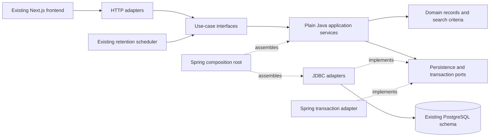

# Clean / Hexagonal Architecture migration

## Decision and implemented scope

Keep the current modular-monolith deployment and PostgreSQL transactions. Migrate by bounded workflow, preserving HTTP contracts, authentication, SQL visibility rules and integration tests. Moving all classes into new folders would not, by itself, separate business policy from infrastructure.

Migrated workflows are private search history, account appearance preferences, profile visibility/public summaries, profile initialization/intro updates, experience/education/certification/project/skill/language CRUD, network invitations/transitions/following/blocking/discovery/privacy, posts/feed/drafts/comments/replies, session management/provider revocation/security time policies, reporting/moderation, notification management, people discovery, job preferences and organization management. Other business controllers still use the existing implementation. This is a working architecture migration, not a claim that the entire backend already meets these boundaries.

Arrows to ports represent source dependencies; at runtime the application calls their injected adapters. The application never imports its adapters. Domain code knows neither application services nor frameworks.

## Source layout

| Package | Responsibility |
|---|---|
| `com.meridian.searchhistory.domain` | Immutable history state and normalized, validated search criteria |
| `com.meridian.searchhistory.application` | Input use cases, persistence port, consent/concurrency orchestration |
| `com.meridian.searchhistory.adapter` | HTTP request validation/identity extraction and PostgreSQL implementation |
| `com.meridian.account.domain` | Preference, visibility and summary values |
| `com.meridian.account.application` | Settings use cases, persistence port, conflict/unavailable outcomes |
| `com.meridian.account.adapter` | Existing preference/visibility routes and owner/visibility-filtered SQL |
| `com.meridian.profile.domain/application/adapter` | Profile values, initialization/update use cases and owner-scoped PostgreSQL adapter |
| `com.meridian.profilesections.domain/application/adapter` | Six typed profile sections, date/URL/text policy, normalization, revision-aware CRUD ports and HTTP/JDBC adapters |
| `com.meridian.network.domain/application/adapter` | Connection transitions and actor policy, relationship/discovery use cases, persistence and realtime ports, HTTP/JDBC adapters |
| `com.meridian.content.domain/application/adapter` | Post/draft/comment models, publication and interaction use cases, persistence/visibility ports, HTTP/JDBC adapters |
| `com.meridian.identity.domain/application/adapter` | Time/return policies, session and provider-revocation use cases, JDBC ports/adapters, OIDC/servlet adapters and composition |
| `com.meridian.moderation.domain/application/adapter` | Reporting/review values and policy, moderation use cases, persistence port and HTTP/JDBC adapters |
| `com.meridian.notifications.domain/application/adapter` | Notification views and read-boundary policy, management use cases, persistence/realtime ports and HTTP/JDBC adapters |
| `com.meridian.peoplesearch.domain/application/adapter` | Search criteria, discovery consent use cases, privacy-filtered query port and HTTP/JDBC adapters |
| `com.meridian.jobs.domain/application/adapter` | Shared workplace value and job-preference use cases/adapters; other jobs APIs remain legacy |
| `com.meridian.organizations.domain/application/adapter` | Company values, ownership/retry/follow use cases, persistence port and HTTP/JDBC adapters |
| `com.meridian.shared.application` | Transaction port and transport-independent failure reasons |
| `com.meridian.shared.adapter` | Spring transaction implementation, HTTP failure translation and bean composition |
| `com.meridian` | Existing entry point, security and not-yet-migrated workflows; retention scheduler delegates through the new input port |

The frontend continues using the authoritative OpenAPI contract and generated TypeScript types. It does not depend on Java package topology. No frontend rewrite, API version bump, service split or database migration is needed for this change.

## Dependency and transaction rules

1. Domain uses the JDK only. Application depends on domain and inward-facing interfaces, not Spring, SQL, HTTP, identity-provider types or adapters.
2. HTTP adapters derive the caller from the authenticated OIDC principal. An owner identifier is never accepted from request JSON for these workflows. Security/CSRF enforcement remains in the existing Spring Security filter chain.
3. Application services own use-case transaction boundaries through `Transactions`. The Spring adapter uses REQUIRED transactions and REPEATABLE_READ read-only history snapshots. Exceptions propagate through the transaction callback before HTTP translation, preserving rollback.
4. Persistence ports describe required semantics. JDBC implementations retain conditional updates, owner predicates, row locks, uniqueness and visibility/blocking filters. Moving SQL out of controllers does not move authorization into the browser.
5. Search-history mutations serialize on the owner profile row. Consent revision checks, disabling/clearing, expiry removal and insertion/capping remain within one transaction. The bounded retention worker now calls a use case instead of executing its own SQL.
6. Preference initialization remains a transactional GET for compatibility. Preference/visibility writes retain compare-and-swap version semantics. Missing public profiles still yield 401 for guests and 404 for authenticated viewers. Public summary and history responses retain `Cache-Control: no-store`.
7. Spring configuration assembles application services explicitly. Framework annotations live in adapters, not the application/domain core. No new library was introduced.

DTO shape is preserved, including lowercase enum values, timestamps, optional `publicVisible`, status codes and version fields. Existing login redirect handling remains in the HTTP adapter. No change to its local-development callback policy was included.

## Verification and architectural enforcement

`HexagonalArchitectureTest` compiles all migrated domain/application sources using an empty dependency classpath and source path. A separate compilation of domain sources prevents application-layer dependencies from entering domain code. These checks run in the normal Maven/CI test phase and require a JDK.

`HexagonalUseCasesTest` exercises stale-consent rejection before persistence, disable/purge sequencing, normalization and guest/member error semantics through ports without a database or Spring context. Existing PostgreSQL integration tests remain the authority for SQL authorization, locking and HTTP behavior. Existing browser tests validate the unchanged client against the rebuilt backend.

The guard applies to migrated packages. It does not certify legacy controllers as clean architecture. Cross-domain SQL in existing workflows and account export projections remains explicit migration debt.

## Remaining migration sequence

| Stage | Existing responsibilities to extract | Compatibility gates |
|---|---|---|
| Profile/media | Photo orchestration, export snapshot access; intro and six section controllers are migrated | Existing profile/photo/export tests, locking/version behavior, S3 failure cleanup |
| Network extensions | Current invitation/follow/block/discovery APIs migrated; future ranked suggestions/rate limits remain product backlog | Concurrent invitation transitions, privacy, outbox atomicity |
| Content extensions | Existing posts/drafts/comments and moderation migrated; future content/media workflows remain product backlog | Ownership/visibility, atomic draft publication, report audit |
| Messaging/notification delivery | Conversation state, ordering/read receipts, projection and realtime delivery; notification management APIs migrated | Idempotent sends, reconnect, cross-user isolation, redelivery |
| Organizations/jobs | Company ownership, recruiter access, application questions and lifecycle | Delegation, immutable question snapshots, duplicate prevention |
| Identity/data lifecycle | Session/provider revocation migrated; export orchestration and future OTP/deletion workflows remain | Real Keycloak lifecycle, rollback/retries, retention and revocation |
| Operations | Event workers, external storage, telemetry boundaries | Outbox/DLQ/recovery tests and runtime failure drills |

For each stage, add ports around business operations, preserve the original transaction boundary and contract, migrate callers, and run integration/browser checks before deleting the old implementation. Do not create generic repositories that leak SQL or Spring types into the core. Do not split services until ownership and operational requirements justify it. See `../remaining-backlog.md` for product requirements, which this refactor does not mark complete.

## Executed verification

The refactored backend container was rebuilt and started with the existing Compose/LocalStack configuration and passed readiness checks. `./scripts/verify.sh` then passed **126 backend tests**, generated OpenAPI consistency, strict TypeScript and **all 34 real-service Playwright journeys**. All 43 existing migrations applied in fresh integration-test databases; no migration or public contract was changed. The browser suite ran against the rebuilt backend, not a mocked API or an old application image.

No real AWS deployment or hosted CI run was performed. These results verify the current migration increment; they do not certify unimplemented backlog features or the remaining legacy architecture.

## Profile migration details

`ProfileUseCases` owns first-access initialization and optimistic profile updates. `ProfileSectionsUseCases` owns six typed section workflows; no untyped field maps or arbitrary table names cross its ports. Input adapters retain the original Jakarta validation and JSON names. Core validation also protects non-HTTP callers, with an injected clock for date rules. Skill/language normalization remains case-preserving in display values and uses locale-independent keys in the JDBC adapter.

All section saves/deletes retain owner and version predicates. JDBC duplicate-key failures become a false conditional-write result; application services raise a conflict inside the transaction, causing rollback. Unavailable, foreign, duplicate and stale entries continue to produce the existing conflict responses. List ordering and 204 deletion responses are unchanged. Intro updates cannot create a missing profile; first-access GET retains the provider name or `New member` fallback. The HTTP CSRF endpoint is unchanged.

`ProfileUseCasesTest` verifies core rejection before persistence, unsafe credential URLs, date ranges/future starts, normalization/revision behavior, owner-scoped deletion and missing-profile update rejection without starting Spring. Existing real-database and browser tests remain the compatibility evidence for the adapters.

### Profile increment verification

- `JAVA_HOME=$(/usr/libexec/java_home -v 21) mvn -q -f apps/backend/pom.xml clean test`: **130 passed**, zero failures/errors/skips. Clean compilation removes stale classes from the former controller locations.
- Rebuilt the backend using Compose with the existing media/observability configuration and verified readiness.
- From `apps/web`, `node check-contract.mjs`, `npm run typecheck` and `npx playwright test`: passed; **all 34 browser journeys passed** against that rebuilt backend.

No new dependency, schema migration or OpenAPI change was required. Existing production deployment limitations and remaining migration stages still apply.

## Network migration details

The network context now exposes `NetworkUseCases` and `NetworkDiscoveryUseCases`. HTTP adapters only extract authenticated identity, validate transport input, call those interfaces and construct the original HTTP responses. `NetworkStore` and `NetworkDiscoveryStore` encapsulate SQL. `NetworkSignals` bridges to the existing after-commit realtime listener via `NetworkRealtimeAdapter`; the domain/application layers contain no Spring event types.

`Action` models the allowed actor, source state and target state. The JDBC adapter independently retains actor/state/version predicates in conditional updates. Invitation replay checks blocking before recognizing an existing owned request. Transition replay only accepts the immediately completed action/version and does not emit another outbox row or realtime signal. Acceptance updates and outbox insertion occur inside the same application transaction.

Follow writes retain the shared pair lock and profile visibility lock. Unfollow remains possible after a target becomes private. Blocking atomically deletes both follow directions, inserts the owner block and closes pending/accepted relationships; invalidation is scheduled in that transaction and delivered only after commit. Missing-target unblock remains an idempotent no-op.

The existing `MemberPairLock` helper remains shared with messaging, recruiting and post access; its lock key and PostgreSQL advisory-lock scope are unchanged. It is public for the migrated outbound adapter, not imported by the core. This temporary infrastructure bridge avoids diverging lock protocols while other domains are migrated.

Suggestions and mutual connections retain the original consent/discoverability/blocking predicates. Mutual discovery distinguishes forbidden targets from an authorized empty list using an optional port result. Cursor order, page sizes, masked private-member names, count semantics and no-store responses remain unchanged. Queries and totals still have the original consistency behavior; no new cross-query snapshot guarantee is claimed.

`NetworkUseCasesTest` covers actor restrictions, duplicate effects, invalidation ordering, private-target unfollowing and consent outcomes. The PostgreSQL failure test injects an outbox exception after a conditional acceptance, verifies rollback of state/version and absence of after-commit invalidation, then retries successfully and verifies one event/invalidation. Existing HTTP integration tests cover actual authorization, concurrency, privacy, blocking and idempotent retry outcomes.

### Network increment verification

- `JAVA_HOME=$(/usr/libexec/java_home -v 21) mvn -q -f apps/backend/pom.xml clean test`: **138 passed**, zero failures/errors/skips, including architecture compilation guards and the PostgreSQL outbox-failure rollback/retry test.
- Rebuilt the backend with the existing Compose media/observability configuration; readiness passed.
- From `apps/web`, `node check-contract.mjs`, `npm run typecheck` and `npx playwright test`: passed; **all 34 real-service browser journeys passed** against the rebuilt backend.

Existing OpenAPI schemas, routes, event schema and all 43 migrations are unchanged. This migration does not implement the remaining product backlog or certify the unmigrated domains as hexagonal.

## Content migration details

`PostUseCases`, `DraftUseCases` and `CommentUseCases` provide the inbound boundaries for the existing feed, search/activity, post CRUD, reactions, saves/hiding, drafts, comments and replies. Domain values contain no HTTP, JDBC, Spring or identity-provider types. Input adapters keep the original validation annotations, route signatures, JSON shapes, status codes and no-store headers.

Application services own optimistic version checks, creation retry policy, draft capacity and publication guards, text validation/normalization, visibility checks and transaction scope. JDBC ports retain owner predicates and database constraints. Draft publication calls `PostUseCases.get` inside its transaction rather than calling a controller. It locks the owned draft, inserts one post, marks the draft published, and performs an authorized read before commit. Failure in any step rolls the entire operation back. A valid retry reads the current authorized post and cannot create a duplicate.

`ContentAccess` defines read visibility and pair-before-post locking. `JdbcContentAccess` owns the existing SQL predicate for deleted/moderated posts, audience and bidirectional blocking. Moderation now injects the same `ContentAccess` port; the former legacy helper has been removed. Moderation and content interactions share one visibility/lock implementation.

Comment creation and deletion retain post locking. Parent checks permit only visible, undeleted root comments; read SQL rechecks parent, author blocking and post visibility. Retry matching still includes owner, post, text and parent identity. No new nesting depth, reposting, media, ranking or asynchronous publication behavior is introduced by this structural change.

`ContentUseCasesTest` covers invalid input, visibility denial before reaction writes, draft capacity/replay, publication retry, empty publication and parent-comment denial without Spring. A PostgreSQL test injects a draft-state write failure after post creation and verifies rollback, then retries publication and proves a single persisted post. Existing HTTP/browser tests remain the compatibility evidence for concurrency, moderation takedown, feeds, drafts and threaded replies.

### Content increment verification

The backend container was rebuilt with the existing Compose media/observability configuration and passed readiness checks. A sequential `./scripts/verify.sh` completed with **145 backend tests passed**, generated OpenAPI consistency, strict TypeScript and **all 34 real-service Playwright journeys passed** against the rebuilt backend. All 43 existing migrations remain unchanged.

An earlier test run was invalidated by an overlapping clean build, producing missing-class errors. The final sequential verification above passed without that interference. No new dependencies, API schema changes, migrations or production deployment were introduced. That checkpoint preceded moderation migration; the later moderation increment below records its completion. Other domains remain tracked for migration.

## Security and identity migration details

`Security.java` remains the outer Spring filter-chain composition root. It declares the same route matchers, management-port restriction, API 401 entry point, disabled request cache, OIDC/PKCE setup, interactive login prompt, logout cookie invalidation and filter order. CSRF configuration remains at its existing Spring defaults, including framework OIDC back-channel handling. This refactor does not broaden public endpoints or replace cryptographic token validation.

`BrowserAuthenticationHandlers` handles servlet success/failure/back-channel responses. Redirect destination selection is a pure `SessionPolicy` function accepting only a typed profile UUID or the privacy-return flag, and session hints are consumed before redirect. The existing localhost frontend origin is retained; production origin configuration is still deployment work.

`ProviderSessions` now lives in `identity.adapter` and implements Spring's OIDC session-registry SPI. Spring remains responsible for signatures and protocol claims. Only validated claim values cross `ProviderSessionUseCases`; raw token values are neither passed to persistence nor logged. The application checks configured issuer/client binding, records logout deduplication, deletes matching application sessions and records the count in one transaction. JDBC retains the original SID/subject/issued-time predicate, durable late-write protection and eight-day cleanup. Registry removal deliberately retains bindings until cleanup, as before. The back-channel adapter retains its freshness check and 400/200 no-store responses.

`SessionUseCases` owns session listing, authoritative active checks and owner-scoped individual/all-session revocation. `JdbcSessionStore` exposes management UUIDs rather than authentication cookies. Revocation deletion and audit persistence remain atomic; missing and foreign management IDs have identical idempotent results. Realtime access delegates through `SessionAccess` to the same use-case interface, including provider-revocation checks.

The framework-free `SessionPolicy` uses an injected clock for absolute lifetime, provider logout freshness and recent-authentication windows. The maximum lifetime remains bounded between one minute and seven days; recent authentication remains based on the validated ID token's auth_time, not user-info or profile fields. The servlet lifetime filter and export reauthentication adapter delegate to this policy. `ApplicationBodyLimit` moved to the shared HTTP adapter package with its original job-endpoint filter and size behavior unchanged.

Existing integration tests retain their behavioral assertions; fixture wiring was updated for moved adapters. `IdentityUseCasesTest` adds deterministic boundary-time checks, safe-return selection, provider trust rejection, replay behavior, expired-session view limits and owner revocation semantics. The PostgreSQL audit-failure test verifies that revocation rolls back on audit failure and a later retry deletes/audits once.

### Identity/security increment verification

- The initial `JAVA_HOME=$(/usr/libexec/java_home -v 21) mvn -q -f apps/backend/pom.xml clean test` passed after the adapter moves, including the existing signed-provider-logout and session checks.
- The backend container was rebuilt using the existing Compose media/observability configuration and passed readiness.
- The final sequential `./scripts/verify.sh` passed **153 backend tests** with zero failures/errors/skips, generated OpenAPI consistency, strict TypeScript and **all 34 real-service browser journeys**. These include registration/recovery, TOTP, passkeys/recovery codes, provider logout, session revocation, public/private profiles and export reauthentication.

No route, API schema, migration, identity-provider protocol or deployment target changed. Production security certification and remaining product/migration work are not implied by these regression results.

## Moderation migration details

`ModerationUseCases` provides the boundary for access checks, owner report lists/submission, operator queue and decisions. HTTP adapters retain original DTO validation, paths, status codes, pagination and no-store responses. Transport-independent forbidden/rate-limit failures map to the existing 403/429 responses.

The application layer owns exact retry matching, self-report/self-review restrictions, reporting limits, moderator authorization, revision comparisons and decision orchestration. `ReviewTarget` expresses self-review and immediate replay rules without database or framework types. The JDBC port retains row locking, ownership predicates and constraints. Moderation uses the content context's `ContentAccess` port instead of a controller or legacy helper.

Decision transactions retain operator-row share locking and post-before-report lock order. Takedown, report state/version and audit insert commit together. Audit matching includes reviewer, decision, normalized reason and post revision; an exact replay reads the existing result without another effect. Report submission retains the owner profile lock for the 20-per-day bound and checks exact retries before visibility/throttling, preserving existing behavior.

`ModerationUseCasesTest` exercises queue authorization, author/reporter self-review denial, audit-bound retries and daily-limit handling. The PostgreSQL failure test injects an audit exception after takedown/state writes and verifies both roll back, then confirms one audit/version advancement after successful retry. Existing HTTP and browser tests cover real operator access and immediate content takedown.

### Moderation increment verification

- `JAVA_HOME=$(/usr/libexec/java_home -v 21) mvn -q -f apps/backend/pom.xml clean test`: **158 passed**, zero failures/errors/skips, including the new permission/retry tests and PostgreSQL audit-failure rollback test.
- Rebuilt the backend with the existing Compose media/observability configuration; readiness passed.
- From `apps/web`, `node check-contract.mjs`, `npm run typecheck` and `npx playwright test`: passed; **all 34 real-service browser journeys passed**, including operator authorization and immediate takedown.

No OpenAPI, migration or dependency changes were required. Notifications/messaging, jobs/organizations, media/export orchestration and operational adapters remain migration work.

## Notification management migration details

`NotificationUseCases` owns list pagination, read/unread/dismiss operations, bounded mark-all-read and optimistic preferences. `NotificationStore` contains PostgreSQL access; `NotificationSignals` bridges to the existing after-commit realtime listener. The HTTP controller contains no SQL or business transaction annotations.

The JDBC adapter retains the exact owner, dismissed-state, accepted-connection, blocking and job-application access predicates. Category filters apply to list rows; unread counts and read-through boundaries remain global across the caller's eligible categories. Original separate-query consistency is preserved; no new snapshot guarantee is claimed.

Read-all requires a positive decimal string fitting a signed 64-bit integer and affects only eligible notifications at or below that boundary. It cannot mark newer arrivals read. Individual operations retain their original owner-scoped conditions and 404 behavior. Preferences retain the default enabled/jobs values and nullable-jobs compatibility semantics, with conditional revision updates. Mutations and realtime signal registration share one transaction; delivery remains after commit.

`NotificationUseCasesTest` covers overflow/invalid boundaries, foreign or unavailable mutations, defaults/stale preference changes and category paging/global counters. A PostgreSQL failure test throws during the preference response read, verifies the write rolled back and no after-commit signal fired, then verifies a successful retry. Kafka notification projection and shared realtime transport remain existing adapters awaiting separate migration; this increment changes management APIs only.

### Notification increment verification

- `JAVA_HOME=$(/usr/libexec/java_home -v 21) mvn -q -f apps/backend/pom.xml clean test`: **163 passed**, zero failures/errors/skips, including boundary/ownership tests and PostgreSQL rollback with suppressed after-commit delivery.
- Rebuilt the backend with the existing Compose media/observability configuration; readiness passed.
- From `apps/web`, `node check-contract.mjs`, `npm run typecheck` and `npx playwright test`: passed; **all 34 real-service browser journeys passed** against the rebuilt backend.

OpenAPI, event contracts and all 43 migrations are unchanged. Kafka projection/realtime transport and remaining backend domains are not marked migrated by this checkpoint.

## People discovery and job preferences migration

People discovery now uses `PeopleUseCases` and `PeopleStore`. Criteria validation and cursor-page construction live in the core; JDBC retains member visibility, discovery opt-in, self-exclusion and bidirectional blocking predicates. Discovery preference updates remain owner-scoped compare-and-swap writes and read their persisted result in the same transaction. No query/index/ranking behavior changed.

Job preferences now use `JobPreferenceUseCases` and `JobPreferenceStore`. The core normalizes query/location after validating the original length bounds, preserves optional workplace selection and returns the persisted revision after a successful conditional write. Missing preferences still return empty query/location, null workplace and version zero. `Workplace` moved from a controller-owned enum into `jobs.domain`, used by both preferences and the remaining jobs controller. Enum wire values are unchanged.

`DiscoveryPreferenceUseCasesTest` covers invalid/normalized criteria, stale discovery writes, default preferences, nullable workplace selection and failed preference writes. Existing integration fixture type references were updated to the new domain types without changing behavioral assertions. Full job lifecycle/recruiting and search infrastructure migration remain separate work.

### Discovery/preferences increment verification

The first compile identified integration fixtures referencing the former controller-owned types; these references were migrated to the domain values without changing assertions. The subsequent `JAVA_HOME=$(/usr/libexec/java_home -v 21) mvn -q -f apps/backend/pom.xml clean test` passed **167 tests**, zero failures/errors/skips. The backend container was rebuilt and passed readiness. From `apps/web`, `node check-contract.mjs`, `npm run typecheck` and `npx playwright test` passed, including **all 34 real-service browser journeys** against the rebuilt backend.

API contracts and all 43 migrations remain unchanged. Job lifecycle/recruiting, messaging, projections and the remaining operational adapters still require migration.

## Organization management migration

`OrganizationUseCases` owns company listing/details, creation/editing and follow/unfollow. The HTTP adapter retains DTO validation, route signatures, no-store responses and 204 follow responses. Domain values express normalized company details and exact creation-retry matching.

Application transactions retain initialized-profile requirements and owner-row locking before edits. A version-zero insert collision returns conflict for another owner's company; a nonzero foreign edit remains forbidden. An identical creation retry succeeds only while the persisted company is still revision one. Changed retries and stale edits remain conflicts. Follow remains idempotent and requires an initialized caller/existing company; unfollow remains a no-op for a missing relationship.

`JdbcOrganizationStore` retains existing search/cursor ordering, owner/followed filters, counts and ownership/recruiter projections. The recruiter projection SQL has one shared outer-layer definition, referenced by legacy recruiting helpers until those workflows migrate. No new access rights or organization role model is introduced.

`OrganizationUseCasesTest` covers creation replay, foreign-create versus foreign-edit status semantics, stale edits and follow/unfollow preconditions. Existing integration fixture type references now use the domain write value; assertions and JSON remain unchanged. Recruiting delegation and job lifecycle remain separate migration work.

### Organization increment verification

`JAVA_HOME=$(/usr/libexec/java_home -v 21) mvn -q -f apps/backend/pom.xml clean test` passed **171 tests**, zero failures/errors/skips. The backend container was rebuilt and passed readiness. From `apps/web`, `node check-contract.mjs`, `npm run typecheck` and `npx playwright test` passed, including **all 34 real-service browser journeys** against the rebuilt backend. Company editing/following, jobs and recruiting compatibility were included.

No public API, database migration or dependency changes were required. Recruiting delegation, job lifecycle, messaging and operational adapter migration remain outstanding.
