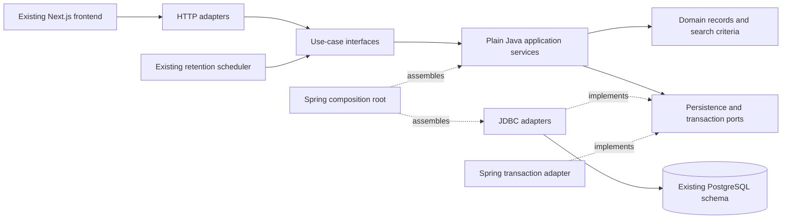

# Clean / Hexagonal Architecture migration

## Decision and implemented scope

Keep the current modular-monolith deployment and PostgreSQL transactions. Migrate by bounded workflow, preserving HTTP contracts, authentication, SQL visibility rules and integration tests. Moving all classes into new folders would not, by itself, separate business policy from infrastructure.

Migrated workflows are private search history, account appearance preferences, profile visibility/public summaries, profile initialization/intro updates, experience/education/certification/project/skill/language CRUD, network invitations/transitions/following/blocking/discovery/privacy, posts/feed/drafts/comments/replies, session management/provider revocation/security time policies, reporting/moderation, notification management, people discovery, job preferences, organization management, job lifecycle/search/bookmark workflows, recruiter delegation and job question management. Other business controllers still use the existing implementation. This is a working architecture migration, not a claim that the entire backend already meets these boundaries.

Arrows to ports represent source dependencies; at runtime the application calls their injected adapters. The application never imports its adapters. Domain code knows neither application services nor frameworks.

## Source layout

| Package | Responsibility |
|---|---|
| `com.meridian.searchhistory.domain` | Immutable history state and normalized, validated search criteria |
| `com.meridian.searchhistory.application` | Input use cases, persistence port, consent/concurrency orchestration |
| `com.meridian.searchhistory.adapter` | HTTP request validation/identity extraction and PostgreSQL implementation |
| `com.meridian.account.domain` | Preference, visibility and summary values |
| `com.meridian.account.application` | Settings use cases, persistence port, conflict/unavailable outcomes |
| `com.meridian.account.adapter` | Existing preference/visibility routes and owner/visibility-filtered SQL |
| `com.meridian.profile.domain/application/adapter` | Profile values, initialization/update use cases and owner-scoped PostgreSQL adapter |
| `com.meridian.profilesections.domain/application/adapter` | Six typed profile sections, date/URL/text policy, normalization, revision-aware CRUD ports and HTTP/JDBC adapters |
| `com.meridian.network.domain/application/adapter` | Connection transitions and actor policy, relationship/discovery use cases, persistence and realtime ports, HTTP/JDBC adapters |
| `com.meridian.content.domain/application/adapter` | Post/draft/comment models, publication and interaction use cases, persistence/visibility ports, HTTP/JDBC adapters |
| `com.meridian.identity.domain/application/adapter` | Time/return policies, session and provider-revocation use cases, JDBC ports/adapters, OIDC/servlet adapters and composition |
| `com.meridian.moderation.domain/application/adapter` | Reporting/review values and policy, moderation use cases, persistence port and HTTP/JDBC adapters |
| `com.meridian.notifications.domain/application/adapter` | Notification views, read-boundary/audience policies, management/projection use cases, persistence/realtime ports and HTTP/JDBC/event adapters |
| `com.meridian.peoplesearch.domain/application/adapter` | Search criteria, discovery consent use cases, privacy-filtered query port and HTTP/JDBC adapters |
| `com.meridian.jobs.domain/application/adapter` | Workplace/job values, preferences, job question management and job lifecycle/search/bookmark use cases, persistence ports and HTTP/JDBC adapters |
| `com.meridian.recruiting.domain/application/adapter` | Recruiter membership state transitions, owner/member use cases, persistence/signaling ports and HTTP/JDBC adapters |
| `com.meridian.organizations.domain/application/adapter` | Company values, ownership/retry/follow use cases, persistence port and HTTP/JDBC adapters |
| `com.meridian.realtime.adapter` | WebSocket transport, authenticated handshake, bounded delivery and immutable after-commit refresh events; session checks call identity use cases |
| `com.meridian.applications.domain/application/adapter` | Application response values, submission/list/history/resume/status use cases, answer/resume policies, persistence/signal ports and HTTP/JDBC adapters |
| `com.meridian.events.domain/application/adapter` | Outbox/delivery values, publication and consumption use cases, persistence/publishing/processing/offset ports, JDBC/Kafka adapters and worker configuration |
| `com.meridian.messaging.domain/application/adapter` | Conversation/message values, read/write use cases, persistence/signal ports and HTTP/JDBC adapters |
| `com.meridian.media.domain/application/adapter` | Shared photo size limit, object storage/maintenance ports, S3 implementation and cleanup scheduler/configuration; photo orchestration remains legacy |
| `com.meridian.exports.domain/application/adapter` | Export state/retry policy, lifecycle/queue/generation use cases, persistence/snapshot/metrics ports and HTTP/JDBC/scheduled adapters |
| `com.meridian.shared.application` | Transaction port and transport-independent failure reasons |
| `com.meridian.shared.adapter` | Spring transaction implementation, HTTP failure translation and bean composition |
| `com.meridian` | Spring Boot entry point and not-yet-migrated workflows; security and retention now live in their adapter packages |

The frontend continues using the authoritative OpenAPI contract and generated TypeScript types. It does not depend on Java package topology. No frontend rewrite, API version bump, service split or database migration is needed for this change.

## Dependency and transaction rules

1. Domain uses the JDK only. Application depends on domain and inward-facing interfaces, not Spring, SQL, HTTP, identity-provider types or adapters.
2. HTTP adapters derive the caller from the authenticated OIDC principal. An owner identifier is never accepted from request JSON for these workflows. Security/CSRF enforcement remains in the existing Spring Security filter chain.
3. Application services own use-case transaction boundaries through `Transactions`. The Spring adapter uses REQUIRED transactions and REPEATABLE_READ read-only history snapshots. Exceptions propagate through the transaction callback before HTTP translation, preserving rollback.
4. Persistence ports describe required semantics. JDBC implementations retain conditional updates, owner predicates, row locks, uniqueness and visibility/blocking filters. Moving SQL out of controllers does not move authorization into the browser.
5. Search-history mutations serialize on the owner profile row. Consent revision checks, disabling/clearing, expiry removal and insertion/capping remain within one transaction. The bounded retention worker now calls a use case instead of executing its own SQL.
6. Preference initialization remains a transactional GET for compatibility. Preference/visibility writes retain compare-and-swap version semantics. Missing public profiles still yield 401 for guests and 404 for authenticated viewers. Public summary and history responses retain `Cache-Control: no-store`.
7. Spring configuration assembles application services explicitly. Framework annotations live in adapters, not the application/domain core. No new library was introduced.

DTO shape is preserved, including lowercase enum values, timestamps, optional `publicVisible`, status codes and version fields. Existing login redirect handling remains in the HTTP adapter. No change to its local-development callback policy was included.

## Verification and architectural enforcement

`HexagonalArchitectureTest` compiles all migrated domain/application sources using an empty dependency classpath and source path. A separate compilation of domain sources prevents application-layer dependencies from entering domain code. These checks run in the normal Maven/CI test phase and require a JDK.

`HexagonalUseCasesTest` exercises stale-consent rejection before persistence, disable/purge sequencing, normalization and guest/member error semantics through ports without a database or Spring context. Existing PostgreSQL integration tests remain the authority for SQL authorization, locking and HTTP behavior. Existing browser tests validate the unchanged client against the rebuilt backend.

The guard applies to migrated packages. It does not certify legacy controllers as clean architecture. Cross-domain SQL in existing workflows and account export projections remains explicit migration debt.

## Remaining migration sequence

| Stage | Existing responsibilities to extract | Compatibility gates |
|---|---|---|
| Profile/media | Photo orchestration, export snapshot access; intro and six section controllers are migrated | Existing profile/photo/export tests, locking/version behavior, S3 failure cleanup |
| Network extensions | Current invitation/follow/block/discovery APIs migrated; future ranked suggestions/rate limits remain product backlog | Concurrent invitation transitions, privacy, outbox atomicity |
| Content extensions | Existing posts/drafts/comments and moderation migrated; future content/media workflows remain product backlog | Ownership/visibility, atomic draft publication, report audit |
| Messaging/notification delivery | Conversation state and ordering/read receipts; notification management/projection and realtime transport adapter boundaries migrated | Idempotent sends, reconnect, cross-user isolation, redelivery |
| Recruiting/applications | Company management, job lifecycle and recruiter delegation migrated; existing application submission/review and answer snapshot orchestration migrated; future application capabilities remain product backlog | Delegation, immutable question snapshots, duplicate prevention |
| Identity/data lifecycle | Session/provider revocation migrated; export orchestration and future OTP/deletion workflows remain | Real Keycloak lifecycle, rollback/retries, retention and revocation |
| Operations | Event workers, external storage, telemetry boundaries | Outbox/DLQ/recovery tests and runtime failure drills |

For each stage, add ports around business operations, preserve the original transaction boundary and contract, migrate callers, and run integration/browser checks before deleting the old implementation. Do not create generic repositories that leak SQL or Spring types into the core. Do not split services until ownership and operational requirements justify it. See `../remaining-backlog.md` for product requirements, which this refactor does not mark complete.

## Executed verification

The refactored backend container was rebuilt and started with the existing Compose/LocalStack configuration and passed readiness checks. `./scripts/verify.sh` then passed **126 backend tests**, generated OpenAPI consistency, strict TypeScript and **all 34 real-service Playwright journeys**. All 43 existing migrations applied in fresh integration-test databases; no migration or public contract was changed. The browser suite ran against the rebuilt backend, not a mocked API or an old application image.

No real AWS deployment or hosted CI run was performed. These results verify the current migration increment; they do not certify unimplemented backlog features or the remaining legacy architecture.

## Profile migration details

`ProfileUseCases` owns first-access initialization and optimistic profile updates. `ProfileSectionsUseCases` owns six typed section workflows; no untyped field maps or arbitrary table names cross its ports. Input adapters retain the original Jakarta validation and JSON names. Core validation also protects non-HTTP callers, with an injected clock for date rules. Skill/language normalization remains case-preserving in display values and uses locale-independent keys in the JDBC adapter.

All section saves/deletes retain owner and version predicates. JDBC duplicate-key failures become a false conditional-write result; application services raise a conflict inside the transaction, causing rollback. Unavailable, foreign, duplicate and stale entries continue to produce the existing conflict responses. List ordering and 204 deletion responses are unchanged. Intro updates cannot create a missing profile; first-access GET retains the provider name or `New member` fallback. The HTTP CSRF endpoint is unchanged.

`ProfileUseCasesTest` verifies core rejection before persistence, unsafe credential URLs, date ranges/future starts, normalization/revision behavior, owner-scoped deletion and missing-profile update rejection without starting Spring. Existing real-database and browser tests remain the compatibility evidence for the adapters.

### Profile increment verification

- `JAVA_HOME=$(/usr/libexec/java_home -v 21) mvn -q -f apps/backend/pom.xml clean test`: **130 passed**, zero failures/errors/skips. Clean compilation removes stale classes from the former controller locations.
- Rebuilt the backend using Compose with the existing media/observability configuration and verified readiness.
- From `apps/web`, `node check-contract.mjs`, `npm run typecheck` and `npx playwright test`: passed; **all 34 browser journeys passed** against that rebuilt backend.

No new dependency, schema migration or OpenAPI change was required. Existing production deployment limitations and remaining migration stages still apply.

## Network migration details

The network context now exposes `NetworkUseCases` and `NetworkDiscoveryUseCases`. HTTP adapters only extract authenticated identity, validate transport input, call those interfaces and construct the original HTTP responses. `NetworkStore` and `NetworkDiscoveryStore` encapsulate SQL. `NetworkSignals` bridges to the existing after-commit realtime listener via `NetworkRealtimeAdapter`; the domain/application layers contain no Spring event types.

`Action` models the allowed actor, source state and target state. The JDBC adapter independently retains actor/state/version predicates in conditional updates. Invitation replay checks blocking before recognizing an existing owned request. Transition replay only accepts the immediately completed action/version and does not emit another outbox row or realtime signal. Acceptance updates and outbox insertion occur inside the same application transaction.

Follow writes retain the shared pair lock and profile visibility lock. Unfollow remains possible after a target becomes private. Blocking atomically deletes both follow directions, inserts the owner block and closes pending/accepted relationships; invalidation is scheduled in that transaction and delivered only after commit. Missing-target unblock remains an idempotent no-op.

The existing `MemberPairLock` helper remains shared with messaging, recruiting and post access; its lock key and PostgreSQL advisory-lock scope are unchanged. It is public for the migrated outbound adapter, not imported by the core. This temporary infrastructure bridge avoids diverging lock protocols while other domains are migrated.

Suggestions and mutual connections retain the original consent/discoverability/blocking predicates. Mutual discovery distinguishes forbidden targets from an authorized empty list using an optional port result. Cursor order, page sizes, masked private-member names, count semantics and no-store responses remain unchanged. Queries and totals still have the original consistency behavior; no new cross-query snapshot guarantee is claimed.

`NetworkUseCasesTest` covers actor restrictions, duplicate effects, invalidation ordering, private-target unfollowing and consent outcomes. The PostgreSQL failure test injects an outbox exception after a conditional acceptance, verifies rollback of state/version and absence of after-commit invalidation, then retries successfully and verifies one event/invalidation. Existing HTTP integration tests cover actual authorization, concurrency, privacy, blocking and idempotent retry outcomes.

### Network increment verification

- `JAVA_HOME=$(/usr/libexec/java_home -v 21) mvn -q -f apps/backend/pom.xml clean test`: **138 passed**, zero failures/errors/skips, including architecture compilation guards and the PostgreSQL outbox-failure rollback/retry test.
- Rebuilt the backend with the existing Compose media/observability configuration; readiness passed.
- From `apps/web`, `node check-contract.mjs`, `npm run typecheck` and `npx playwright test`: passed; **all 34 real-service browser journeys passed** against the rebuilt backend.

Existing OpenAPI schemas, routes, event schema and all 43 migrations are unchanged. This migration does not implement the remaining product backlog or certify the unmigrated domains as hexagonal.

## Content migration details

`PostUseCases`, `DraftUseCases` and `CommentUseCases` provide the inbound boundaries for the existing feed, search/activity, post CRUD, reactions, saves/hiding, drafts, comments and replies. Domain values contain no HTTP, JDBC, Spring or identity-provider types. Input adapters keep the original validation annotations, route signatures, JSON shapes, status codes and no-store headers.

Application services own optimistic version checks, creation retry policy, draft capacity and publication guards, text validation/normalization, visibility checks and transaction scope. JDBC ports retain owner predicates and database constraints. Draft publication calls `PostUseCases.get` inside its transaction rather than calling a controller. It locks the owned draft, inserts one post, marks the draft published, and performs an authorized read before commit. Failure in any step rolls the entire operation back. A valid retry reads the current authorized post and cannot create a duplicate.

`ContentAccess` defines read visibility and pair-before-post locking. `JdbcContentAccess` owns the existing SQL predicate for deleted/moderated posts, audience and bidirectional blocking. Moderation now injects the same `ContentAccess` port; the former legacy helper has been removed. Moderation and content interactions share one visibility/lock implementation.

Comment creation and deletion retain post locking. Parent checks permit only visible, undeleted root comments; read SQL rechecks parent, author blocking and post visibility. Retry matching still includes owner, post, text and parent identity. No new nesting depth, reposting, media, ranking or asynchronous publication behavior is introduced by this structural change.

`ContentUseCasesTest` covers invalid input, visibility denial before reaction writes, draft capacity/replay, publication retry, empty publication and parent-comment denial without Spring. A PostgreSQL test injects a draft-state write failure after post creation and verifies rollback, then retries publication and proves a single persisted post. Existing HTTP/browser tests remain the compatibility evidence for concurrency, moderation takedown, feeds, drafts and threaded replies.

### Content increment verification

The backend container was rebuilt with the existing Compose media/observability configuration and passed readiness checks. A sequential `./scripts/verify.sh` completed with **145 backend tests passed**, generated OpenAPI consistency, strict TypeScript and **all 34 real-service Playwright journeys passed** against the rebuilt backend. All 43 existing migrations remain unchanged.

An earlier test run was invalidated by an overlapping clean build, producing missing-class errors. The final sequential verification above passed without that interference. No new dependencies, API schema changes, migrations or production deployment were introduced. That checkpoint preceded moderation migration; the later moderation increment below records its completion. Other domains remain tracked for migration.

## Security and identity migration details

`Security.java` remains the outer Spring filter-chain composition root. It declares the same route matchers, management-port restriction, API 401 entry point, disabled request cache, OIDC/PKCE setup, interactive login prompt, logout cookie invalidation and filter order. CSRF configuration remains at its existing Spring defaults, including framework OIDC back-channel handling. This refactor does not broaden public endpoints or replace cryptographic token validation.

`BrowserAuthenticationHandlers` handles servlet success/failure/back-channel responses. Redirect destination selection is a pure `SessionPolicy` function accepting only a typed profile UUID or the privacy-return flag, and session hints are consumed before redirect. The existing localhost frontend origin is retained; production origin configuration is still deployment work.

`ProviderSessions` now lives in `identity.adapter` and implements Spring's OIDC session-registry SPI. Spring remains responsible for signatures and protocol claims. Only validated claim values cross `ProviderSessionUseCases`; raw token values are neither passed to persistence nor logged. The application checks configured issuer/client binding, records logout deduplication, deletes matching application sessions and records the count in one transaction. JDBC retains the original SID/subject/issued-time predicate, durable late-write protection and eight-day cleanup. Registry removal deliberately retains bindings until cleanup, as before. The back-channel adapter retains its freshness check and 400/200 no-store responses.

`SessionUseCases` owns session listing, authoritative active checks and owner-scoped individual/all-session revocation. `JdbcSessionStore` exposes management UUIDs rather than authentication cookies. Revocation deletion and audit persistence remain atomic; missing and foreign management IDs have identical idempotent results. Realtime access delegates through `SessionAccess` to the same use-case interface, including provider-revocation checks.

The framework-free `SessionPolicy` uses an injected clock for absolute lifetime, provider logout freshness and recent-authentication windows. The maximum lifetime remains bounded between one minute and seven days; recent authentication remains based on the validated ID token's auth_time, not user-info or profile fields. The servlet lifetime filter and export reauthentication adapter delegate to this policy. `ApplicationBodyLimit` moved to the shared HTTP adapter package with its original job-endpoint filter and size behavior unchanged.

Existing integration tests retain their behavioral assertions; fixture wiring was updated for moved adapters. `IdentityUseCasesTest` adds deterministic boundary-time checks, safe-return selection, provider trust rejection, replay behavior, expired-session view limits and owner revocation semantics. The PostgreSQL audit-failure test verifies that revocation rolls back on audit failure and a later retry deletes/audits once.

### Identity/security increment verification

- The initial `JAVA_HOME=$(/usr/libexec/java_home -v 21) mvn -q -f apps/backend/pom.xml clean test` passed after the adapter moves, including the existing signed-provider-logout and session checks.
- The backend container was rebuilt using the existing Compose media/observability configuration and passed readiness.
- The final sequential `./scripts/verify.sh` passed **153 backend tests** with zero failures/errors/skips, generated OpenAPI consistency, strict TypeScript and **all 34 real-service browser journeys**. These include registration/recovery, TOTP, passkeys/recovery codes, provider logout, session revocation, public/private profiles and export reauthentication.

No route, API schema, migration, identity-provider protocol or deployment target changed. Production security certification and remaining product/migration work are not implied by these regression results.

## Moderation migration details

`ModerationUseCases` provides the boundary for access checks, owner report lists/submission, operator queue and decisions. HTTP adapters retain original DTO validation, paths, status codes, pagination and no-store responses. Transport-independent forbidden/rate-limit failures map to the existing 403/429 responses.

The application layer owns exact retry matching, self-report/self-review restrictions, reporting limits, moderator authorization, revision comparisons and decision orchestration. `ReviewTarget` expresses self-review and immediate replay rules without database or framework types. The JDBC port retains row locking, ownership predicates and constraints. Moderation uses the content context's `ContentAccess` port instead of a controller or legacy helper.

Decision transactions retain operator-row share locking and post-before-report lock order. Takedown, report state/version and audit insert commit together. Audit matching includes reviewer, decision, normalized reason and post revision; an exact replay reads the existing result without another effect. Report submission retains the owner profile lock for the 20-per-day bound and checks exact retries before visibility/throttling, preserving existing behavior.

`ModerationUseCasesTest` exercises queue authorization, author/reporter self-review denial, audit-bound retries and daily-limit handling. The PostgreSQL failure test injects an audit exception after takedown/state writes and verifies both roll back, then confirms one audit/version advancement after successful retry. Existing HTTP and browser tests cover real operator access and immediate content takedown.

### Moderation increment verification

- `JAVA_HOME=$(/usr/libexec/java_home -v 21) mvn -q -f apps/backend/pom.xml clean test`: **158 passed**, zero failures/errors/skips, including the new permission/retry tests and PostgreSQL audit-failure rollback test.
- Rebuilt the backend with the existing Compose media/observability configuration; readiness passed.
- From `apps/web`, `node check-contract.mjs`, `npm run typecheck` and `npx playwright test`: passed; **all 34 real-service browser journeys passed**, including operator authorization and immediate takedown.

No OpenAPI, migration or dependency changes were required. Notifications/messaging, jobs/organizations, media/export orchestration and operational adapters remain migration work.

## Notification management migration details

`NotificationUseCases` owns list pagination, read/unread/dismiss operations, bounded mark-all-read and optimistic preferences. `NotificationStore` contains PostgreSQL access; `NotificationSignals` bridges to the existing after-commit realtime listener. The HTTP controller contains no SQL or business transaction annotations.

The JDBC adapter retains the exact owner, dismissed-state, accepted-connection, blocking and job-application access predicates. Category filters apply to list rows; unread counts and read-through boundaries remain global across the caller's eligible categories. Original separate-query consistency is preserved; no new snapshot guarantee is claimed.

Read-all requires a positive decimal string fitting a signed 64-bit integer and affects only eligible notifications at or below that boundary. It cannot mark newer arrivals read. Individual operations retain their original owner-scoped conditions and 404 behavior. Preferences retain the default enabled/jobs values and nullable-jobs compatibility semantics, with conditional revision updates. Mutations and realtime signal registration share one transaction; delivery remains after commit.

`NotificationUseCasesTest` covers overflow/invalid boundaries, foreign or unavailable mutations, defaults/stale preference changes and category paging/global counters. A PostgreSQL failure test throws during the preference response read, verifies the write rolled back and no after-commit signal fired, then verifies a successful retry. Kafka notification projection and shared realtime transport remain existing adapters awaiting separate migration; this increment changes management APIs only.

### Notification increment verification

- `JAVA_HOME=$(/usr/libexec/java_home -v 21) mvn -q -f apps/backend/pom.xml clean test`: **163 passed**, zero failures/errors/skips, including boundary/ownership tests and PostgreSQL rollback with suppressed after-commit delivery.
- Rebuilt the backend with the existing Compose media/observability configuration; readiness passed.
- From `apps/web`, `node check-contract.mjs`, `npm run typecheck` and `npx playwright test`: passed; **all 34 real-service browser journeys passed** against the rebuilt backend.

OpenAPI, event contracts and all 43 migrations are unchanged. Kafka projection/realtime transport and remaining backend domains are not marked migrated by this checkpoint.

## People discovery and job preferences migration

People discovery now uses `PeopleUseCases` and `PeopleStore`. Criteria validation and cursor-page construction live in the core; JDBC retains member visibility, discovery opt-in, self-exclusion and bidirectional blocking predicates. Discovery preference updates remain owner-scoped compare-and-swap writes and read their persisted result in the same transaction. No query/index/ranking behavior changed.

Job preferences now use `JobPreferenceUseCases` and `JobPreferenceStore`. The core normalizes query/location after validating the original length bounds, preserves optional workplace selection and returns the persisted revision after a successful conditional write. Missing preferences still return empty query/location, null workplace and version zero. `Workplace` moved from a controller-owned enum into `jobs.domain`, used by both preferences and the remaining jobs controller. Enum wire values are unchanged.

`DiscoveryPreferenceUseCasesTest` covers invalid/normalized criteria, stale discovery writes, default preferences, nullable workplace selection and failed preference writes. Existing integration fixture type references were updated to the new domain types without changing behavioral assertions. Full job lifecycle/recruiting and search infrastructure migration remain separate work.

### Discovery/preferences increment verification

The first compile identified integration fixtures referencing the former controller-owned types; these references were migrated to the domain values without changing assertions. The subsequent `JAVA_HOME=$(/usr/libexec/java_home -v 21) mvn -q -f apps/backend/pom.xml clean test` passed **167 tests**, zero failures/errors/skips. The backend container was rebuilt and passed readiness. From `apps/web`, `node check-contract.mjs`, `npm run typecheck` and `npx playwright test` passed, including **all 34 real-service browser journeys** against the rebuilt backend.

API contracts and all 43 migrations remain unchanged. Job lifecycle/recruiting, messaging, projections and the remaining operational adapters still require migration.

## Organization management migration

`OrganizationUseCases` owns company listing/details, creation/editing and follow/unfollow. The HTTP adapter retains DTO validation, route signatures, no-store responses and 204 follow responses. Domain values express normalized company details and exact creation-retry matching.

Application transactions retain initialized-profile requirements and owner-row locking before edits. A version-zero insert collision returns conflict for another owner's company; a nonzero foreign edit remains forbidden. An identical creation retry succeeds only while the persisted company is still revision one. Changed retries and stale edits remain conflicts. Follow remains idempotent and requires an initialized caller/existing company; unfollow remains a no-op for a missing relationship.

`JdbcOrganizationStore` retains existing search/cursor ordering, owner/followed filters, counts and ownership/recruiter projections. The recruiter projection SQL has one shared outer-layer definition, referenced by legacy recruiting helpers until those workflows migrate. No new access rights or organization role model is introduced.

`OrganizationUseCasesTest` covers creation replay, foreign-create versus foreign-edit status semantics, stale edits and follow/unfollow preconditions. Existing integration fixture type references now use the domain write value; assertions and JSON remain unchanged. Recruiting delegation and job lifecycle remain separate migration work.

### Organization increment verification

`JAVA_HOME=$(/usr/libexec/java_home -v 21) mvn -q -f apps/backend/pom.xml clean test` passed **171 tests**, zero failures/errors/skips. The backend container was rebuilt and passed readiness. From `apps/web`, `node check-contract.mjs`, `npm run typecheck` and `npx playwright test` passed, including **all 34 real-service browser journeys** against the rebuilt backend. Company editing/following, jobs and recruiting compatibility were included.

No public API, database migration or dependency changes were required. Recruiting delegation, job lifecycle, messaging and operational adapter migration remain outstanding.

## Job lifecycle migration checkpoint

Job publication, edits, closing/reopening, discovery, detail reads and saved/dismissed markers now use `jobs.domain` values, `JobUseCases`, `JobStore`, `JobService` and HTTP/JDBC adapters. The Spring composition root supplies the transaction port. The root `JobController` was removed; its request validation and wire fields remain in the HTTP adapter. Public paths, response schemas, no-store headers and marker 204 responses are unchanged.

The application layer owns validation, organization authorization sequencing, immutable company assignment, creation retry matching and optimistic-version conflicts. The JDBC adapter preserves organization/job row locks and existing SQL filters, cursor order, recruiter projection and marker uniqueness. Publication and marker mutations retain their transaction boundaries. Job preference matching and dismissed-job exclusion remain authoritative database queries. Recruiter delegation and application/question orchestration still require extraction; shared recruiter SQL remains an explicitly outer-layer dependency between adapters.

Three new `JobUseCasesTest` cases cover unauthorized recruiting writes, open-only creation/company mismatch and creation replay/idempotent marker removal. Existing database and HTTP integration tests continue exercising publication, filtering, concurrent versions, bookmarks and recruiting compatibility. Framework-free compilation guards cover the new domain/application classes.

Executed verification:

- `JAVA_HOME=$(/usr/libexec/java_home -v 21) mvn -q -f apps/backend/pom.xml clean test`: **174 tests**, zero failures, errors or skips.
- `docker compose --ansi never --progress plain --env-file .env -f infrastructure/local/compose.yml -f infrastructure/local/compose.media.yml --profile app --profile observability up -d --build --wait --wait-timeout 180 backend`: rebuilt backend and successful readiness.
- From `apps/web`, `node check-contract.mjs`, `npm run typecheck` and `npx playwright test`: contract consistency, strict TypeScript and **34 real-service browser journeys passed**.

No API contract, database migration or dependency change was required. No AWS deployment occurred. Messaging, notification projection/delivery, recruiting/applications/questions, photo/export orchestration and operational adapters remain migration work.

## Recruiter delegation migration checkpoint

Recruiter invitations, access listing and ACCEPT/DECLINE/LEAVE/REVOKE transitions now use `recruiting.domain`, `RecruiterUseCases`, `RecruiterStore` and `RecruiterSignals`. `RecruiterService` owns authorization sequencing, accepted/unblocked connection checks, capacity limits, invitation replay and membership version checks. HTTP validation and no-store responses remain in the adapter; SQL and locks remain in `JdbcRecruiterStore`. The former root controller was removed. The composition root supplies the store, transaction and signal ports.

Invitation writes retain organization-then-member-pair locking. Membership changes retain organization-then-membership locking. State updates, audit writes and signal registration execute in the same transaction. `RecruiterRealtimeAdapter` bridges to the existing after-commit listener and carries only affected subjects. At this checkpoint it remained a root-package adapter because the legacy event was package-private; the subsequent realtime checkpoint below removes this constraint.

The existing recruiting integration assertions remain unchanged, including immediate loss of job/application access after revocation, CSRF enforcement, creation retries, duplicate active invitations, stale changes and self-review restrictions. Five new core tests cover owner authorization, replay without duplicate writes/signals, blocked connections/capacity, action/version checks and terminal-state transitions. Framework-independent compilation guards include the new core packages.

Application submission/review, question snapshots, messaging, notification projection/delivery, photo/export orchestration and operational adapters still require migration. Existing legacy recruiting helpers remain for application/question workflows. No API schema, database migration or dependency change was introduced.

Executed verification for recruiter delegation:

- `JAVA_HOME=$(/usr/libexec/java_home -v 21) mvn -q -f apps/backend/pom.xml clean test`: **179 tests**, zero failures, errors or skips.
- `docker compose --ansi never --progress plain --env-file .env -f infrastructure/local/compose.yml -f infrastructure/local/compose.media.yml --profile app --profile observability up -d --build --wait --wait-timeout 180 backend`: backend rebuilt and ready.
- From `apps/web`, `node check-contract.mjs`, `npm run typecheck` and `npx playwright test`: contract consistency, strict TypeScript and **all 34 real-service browser journeys passed** against the rebuilt backend.

No AWS deployment or production-readiness claim is made. This verification covers the current incremental migration.

## Realtime adapter boundary checkpoint

`RecruiterRealtimeAdapter`, `NetworkRealtimeAdapter` and `NotificationRealtimeAdapter` now live in their owning context adapter packages. They implement the existing application signal ports. The shared `RealtimeChanged`, `RealtimeHandler` and `RealtimeConfiguration` live in `realtime.adapter`, removing the root-package visibility constraint described in the prior checkpoint. This is transport infrastructure, not a new business domain or independently deployed service.

The WebSocket adapter calls the identity `SessionUseCases` input port directly; the pass-through `identity.adapter.SessionAccess` class was removed. Legacy messaging/application controllers and notification projection explicitly import the shared adapter event until those workflows migrate. The event remains a local invalidation signal, not a durable domain event or Kafka contract.

The existing `/api/v1/realtime` path, exact origin checks, authenticated subject/session binding, refresh JSON, connection limits, bounded executor, send limits, periodic session revocation checks and shutdown behavior are preserved. The listener now explicitly declares AFTER_COMMIT with fallback disabled. Audience sets are defensively copied so callers cannot change queued recipients. Tests cover committed versus rolled-back/nontransactional events, immutable audience, session-store failure, remote revocation and subject isolation.

Application/question workflows, messaging use cases, notification projections and operational workers remain migration work. No public API, dependency or database migration changed.

Executed verification for the realtime boundary migration:

- `JAVA_HOME=$(/usr/libexec/java_home -v 21) mvn -q -f apps/backend/pom.xml clean test`: **181 tests**, zero failures, errors or skips.
- `docker compose --ansi never --progress plain --env-file .env -f infrastructure/local/compose.yml -f infrastructure/local/compose.media.yml --profile app --profile observability up -d --build --wait --wait-timeout 180 backend`: rebuilt backend passed readiness.
- From `apps/web`, `node check-contract.mjs`, `npm run typecheck` and `npx playwright test`: contract consistency, strict TypeScript and **34 real-service browser journeys passed** against the rebuilt backend.

No AWS deployment occurred. Distributed realtime scaling and the remaining legacy workflows are not certified by this incremental verification.

## Job question management migration checkpoint

The existing GET/PUT `/api/v1/jobs/{jobId}/questions` endpoints now delegate through `JobQuestionUseCases` to `JobQuestionService`, using `JobQuestionStore` and the shared transaction port. `JobQuestions` is a framework-free domain model with question limits, duplicate-ID detection, text validation and normalization. The HTTP adapter retains Jakarta request validation and no-store responses; `JdbcJobQuestionStore` owns JSON persistence and SQL.

Save retains job lookup, organization lock, recruiter authorization, job lock, version check, normalization and write ordering. First save inserts revision one; later saves increment the existing revision. Reload occurs inside the write transaction. Missing jobs/companies, forbidden recruiter access and stale revisions preserve their HTTP outcomes.

Legacy application submission still owns answer validation and immutable submitted snapshots. Its `ApplicationQuestions.load` bridge delegates to the new JDBC reader and maps to the existing submission DTOs, avoiding two database readers during incremental migration. The old root question controller and unused normalization implementation were removed. Application submission/review and answer snapshot orchestration remain outstanding, along with messaging, notification projection, media/export and workers.

Four new `JobQuestionUseCasesTest` tests cover missing/unauthorized access, stale revisions, lock/write ordering with persisted revision, and invalid question sets. Existing integration and browser assertions continue checking stale applications and preserved answer snapshots. No public contract, migration or dependency changed.

Executed verification for job question management:

- `JAVA_HOME=$(/usr/libexec/java_home -v 21) mvn -q -f apps/backend/pom.xml clean test`: **185 tests**, zero failures, errors or skips.
- `docker compose --ansi never --progress plain --env-file .env -f infrastructure/local/compose.yml -f infrastructure/local/compose.media.yml --profile app --profile observability up -d --build --wait --wait-timeout 180 backend`: rebuilt backend passed readiness.
- From `apps/web`, `node check-contract.mjs`, `npm run typecheck` and `npx playwright test`: contract consistency, strict TypeScript and **all 34 real-service browser journeys passed** against the rebuilt backend.

No AWS deployment occurred. This verifies the question-management migration, not completion of application lifecycle migration or overall production readiness.

## Application read-side migration checkpoint

Application lists, private status history and resume downloads now use `ApplicationReadUseCases`, `ApplicationReadService` and `ApplicationReadStore`. Framework-free response records live in `applications.domain`; HTTP/JDBC implementations live in `applications.adapter`. List pagination is handled in the application service, while the database adapter applies caller authorization and filters before the 21-row cursor window. History remains one SQL statement so its current version and transitions come from the same statement snapshot.

The adapter retains applicant/owner/active-recruiter visibility predicates, immediate effects of revocation, existing ordering and actor-role projection. Missing and unauthorized history/resume reads retain identical 404 behavior. Resume UTF-8 encoding, attachment filename, no-store, nosniff and restrictive CSP headers are unchanged.

The legacy write controller retains its submission/status transactions, locks, audit/outbox writes and realtime registration. Its receipts use the same JDBC response reader and domain response model as lists, inside the original transaction. This deliberate outer-layer bridge avoids independent response queries while mutation use cases remain to be migrated. Answer snapshots in responses are mapped to framework-free values; persisted JSON remains unchanged.

Three new `ApplicationReadUseCasesTest` cases verify unavailable private resources, cursor boundaries/filter forwarding and authoritative history version/actor roles. Existing integration/browser tests cover application submission, review, resume access, recruiter revocation and immutable answers. No API schema, migration or dependency changed. Submission/review, messaging, notification projection, media/export and workers remain migration work.

Executed verification for the application read-side migration:

- `JAVA_HOME=$(/usr/libexec/java_home -v 21) mvn -q -f apps/backend/pom.xml clean test`: **188 tests**, zero failures, errors or skips.
- `docker compose --ansi never --progress plain --env-file .env -f infrastructure/local/compose.yml -f infrastructure/local/compose.media.yml --profile app --profile observability up -d --build --wait --wait-timeout 180 backend`: rebuilt backend passed readiness.
- From `apps/web`, `node check-contract.mjs`, `npm run typecheck` and `npx playwright test`: contract consistency, strict TypeScript and **all 34 real-service browser journeys passed** against the rebuilt backend.

No AWS deployment occurred. Application mutations and remaining legacy workflows are not marked migrated by these results.

## Application status-transition migration checkpoint

PUT `/api/v1/applications/{id}/status` now delegates to `ApplicationStatusUseCases` and `ApplicationStatusService`. `ApplicationStatus` contains the actor and transition policies; the application layer checks revision and orchestrates `ApplicationStatusStore`, the transaction port and `ApplicationSignals`. HTTP validation, error translation and no-store responses remain in the inbound adapter. `JdbcApplicationStatusStore` retains the original SQL predicates and locks. `ApplicationRealtimeAdapter` publishes the shared after-commit invalidation event.

The service retains caller-filtered organization lookup, organization locking, caller-filtered application locking, actor checks and version checks in order. This revalidates recruiter access after acquiring the organization lock. Status/version, audit and outbox writes and signal registration share one transaction; the persisted response is read before commit. Applicants can withdraw submitted/reviewing applications; reviewers can move submitted to reviewing/rejected or reviewing to accepted/rejected. Terminal states remain terminal, and an applicant with recruiter privileges cannot review their own application.

Four core tests cover access revalidation, wrong actors/stale versions, audit/outbox failure suppression and the full transition matrix. A new PostgreSQL integration test deliberately fails after audit/outbox persistence and verifies rollback of state/version/audit/outbox and absence of a signal. Existing application/recruiter integration assertions remain unchanged. No API schema, migration or dependency change was needed.

Submission, answer validation/snapshot orchestration, messaging, notification projection, media/export and workers remain migration work. The legacy submission controller retains its existing transactional implementation.

Executed verification for status transitions:

- `JAVA_HOME=$(/usr/libexec/java_home -v 21) mvn -q -f apps/backend/pom.xml clean test`: **193 tests**, zero failures, errors or skips.
- `docker compose --ansi never --progress plain --env-file .env -f infrastructure/local/compose.yml -f infrastructure/local/compose.media.yml --profile app --profile observability up -d --build --wait --wait-timeout 180 backend`: rebuilt backend passed readiness.
- From `apps/web`, `node check-contract.mjs` and `npm run typecheck`: passed.
- `npx playwright test`: **31 passed, three failed**. Identity and unified-search failed waiting for navigation after identity-provider form submission; people-search timed out waiting for a result. Application/status and recruiting journeys passed.
- `npx playwright test --last-failed --workers=1`: **all three passed**, without code changes. All 34 journeys therefore passed across the initial run and targeted retry, not in a single clean run. The timing failures were not reproduced and their root cause remains unconfirmed; browser-suite reliability remains an operational/test limitation.

No AWS deployment occurred. Submission and remaining legacy workflows are still tracked separately.

## Application submission migration checkpoint

PUT `/api/v1/jobs/{jobId}/application` now delegates to `ApplicationSubmissionUseCases` and `ApplicationSubmissionService`, with `ApplicationSubmissionStore` and the existing transaction/signal ports. Plain Java `Submission` values own resume and answer validation, original question snapshot reconstruction and supplied-answer normalization. HTTP request annotations remain on the adapter. The shared error translator adds a transport-independent UNPROCESSABLE reason to preserve the existing 422 outcome for missing required answers.

The application layer retains organization/job locking, replay comparison before current-job eligibility checks, question-version checks, company/recruiter exclusion and profile initialization requirements. A replay compares the original statement, resume body and original question/answer snapshots; changed submitted content remains a conflict. Successful creation writes the application, optional resume, audit and outbox atomically and registers realtime invalidation before reading the persisted receipt in the same transaction.

`JdbcApplicationSubmissionStore` shares the existing question reader, receipt reader and organization lock/audience adapter implementations. No core package imports adapters or Spring. Root `ApplicationController`, `ApplicationQuestions`, `ResumeText` and `RecruitingAccess` were removed. Test fixtures now use domain records and a test-only JSON encoder; their HTTP assertions remain unchanged.

Four core tests cover closed-job replay using original snapshots, distinct stale-form/missing-answer errors, invalid answer sets and UTF-8 resume limits. A PostgreSQL integration test fails after audit/outbox writes and verifies application/resume/audit/outbox rollback and no signal. Existing submission, concurrency, recruiter access and snapshot integration checks remain in the suite.

No API schema, database migration or dependency change was required. Messaging, notification projection, media/export and operational workers remain migration work; this is not overall production readiness.

Executed verification for application submission:

- `JAVA_HOME=$(/usr/libexec/java_home -v 21) mvn -q -f apps/backend/pom.xml clean test`: **198 tests**, zero failures, errors or skips.
- `docker compose --ansi never --progress plain --env-file .env -f infrastructure/local/compose.yml -f infrastructure/local/compose.media.yml --profile app --profile observability up -d --build --wait --wait-timeout 180 backend`: rebuilt backend passed readiness.
- From `apps/web`, `node check-contract.mjs` and `npm run typecheck`: passed.
- `npx playwright test --workers=2`: **all 34 real-service journeys passed**, no retries. This reduced-concurrency run does not establish a root cause or permanent fix for the prior higher-concurrency timing failures.

No AWS deployment occurred. Existing application submission/read/status workflows are migrated; unimplemented product features and remaining architectural contexts stay in the backlog.

## Notification projection migration checkpoint

Connection/application notification projection now uses `NotificationProjectionUseCases`, `NotificationProjectionService`, `NotificationProjectionStore` and the existing notification signal and transaction ports. `NotificationSource` selects the application recipient from authoritative audit status. The inbound `NotificationProjector` validates versioned integration envelopes before calling the application layer. Event envelopes moved to `notifications.adapter`; topic names, JSON fields, schema versions and broker validation remain unchanged.

`JdbcNotificationProjectionStore` retains the existing conditional connection insert, blocking checks, notification preferences, audit/outbox source lookup and unique constraints. Connection events are claimed before eligibility projection. Application events are resolved from matching outbox/audit data before claiming, so missing/mismatched source events remain retryable. Opted-out application events are consumed without later backfill. Only a newly inserted notification registers a realtime signal.

Deduplication, source resolution, preferences and inserts execute within the transaction port; realtime delivery remains after commit. Four core tests cover missing sources, opt-out, redelivery and audience/insert outcomes. A new PostgreSQL test fails after notification insertion, verifies deduplication and notification rollback, and verifies a successful single-effect replay. Existing Kafka, privacy and browser integration checks are retained.

Root projector/event classes were removed; the still-legacy Kafka worker imports the inbound adapters explicitly. Kafka polling/outbox publication/retry lifecycle, messaging, media/export and other operational workers remain migration work. No public API, event schema, migration or dependency changed.

Executed verification for notification projection:

- `JAVA_HOME=$(/usr/libexec/java_home -v 21) mvn -q -f apps/backend/pom.xml clean test`: **203 tests**, zero failures, errors or skips.
- `docker compose --ansi never --progress plain --env-file .env -f infrastructure/local/compose.yml -f infrastructure/local/compose.media.yml --profile app --profile observability up -d --build --wait --wait-timeout 180 backend`: rebuilt backend passed readiness.
- From `apps/web`, `node check-contract.mjs`, `npm run typecheck` and `npx playwright test --workers=2`: contract consistency, strict TypeScript and **all 34 real-service journeys passed**, no retries.

No AWS deployment occurred. Remaining Kafka worker lifecycle, messaging and media/export migration is not covered by a completion claim.

## Outbox publication migration checkpoint

Outbox publication now runs through framework-free `OutboxUseCases`/`OutboxService`, `OutboxStore`, `OutboxPublisher`, `OutboxMetrics` and the shared transaction port. `JdbcOutboxStore` retains the existing 20-row SKIP LOCKED selection, due-time filtering and per-application version ordering. `KafkaEventTransport` maps outbox values to the same versioned envelopes, topics and partition keys, and awaits broker acknowledgement with the existing timeouts and producer settings.

Publication remains inside the database transaction. A successful send is followed by the published marker and metric; a failed send schedules the original bounded exponential SQL retry with jitter and stops the batch. Failure to persist retry state escapes for transaction rollback. This remains at-least-once delivery: broker acknowledgement followed by failed database commit can redeliver, and projection consumers retain deduplication.

The worker moved into `events.adapter` and delegates publication to the use case. Its consumer offset commit/seek recovery, strict envelope checks, application DLQ redaction, polling settings and topic initialization remain unchanged infrastructure code. Producer ownership moved to a dedicated transport bean; the worker closes its consumer, and Spring destroys dependent worker beans before closing the transport. Existing metrics names and pending-backlog gauge are retained. Consumer orchestration extraction remains separate migration work.

Three new `OutboxUseCasesTest` tests cover transactional acknowledgement/marker ordering, failed-send batch stopping, and retry-persistence failure propagation. Existing real Kafka/PostgreSQL tests cover broker failure, replay, application ordering and DLQ behavior. No API/event schema, migration or dependency changed. Messaging, media/export and remaining worker orchestration remain outstanding.

Executed verification for outbox publication:

- `JAVA_HOME=$(/usr/libexec/java_home -v 21) mvn -q -f apps/backend/pom.xml clean test`: **206 tests**, zero failures, errors or skips.
- `docker compose --ansi never --progress plain --env-file .env -f infrastructure/local/compose.yml -f infrastructure/local/compose.media.yml --profile app --profile observability up -d --build --wait --wait-timeout 180 backend`: rebuilt backend passed readiness.
- From `apps/web`, `node check-contract.mjs`, `npm run typecheck` and `npx playwright test --workers=2`: contract consistency, strict TypeScript and **all 34 real-service journeys passed**, no retries.

No AWS deployment occurred. Consumer processing orchestration and remaining legacy workflows remain tracked separately.

## Event consumption migration checkpoint

`EventConsumptionService` now owns batch processing, per-partition commit progression and recovery through `EventProcessor` and `DeliveryOffsets`. `EventDelivery` and its partition value contain no Kafka types. The worker maps Kafka records to these values and provides Kafka commit/seek implementations. `NotificationEventProcessor` retains strict JSON envelope parsing, projection dispatch, DLQ send confirmation, application poison-message redaction and quarantine metrics in the outer adapter.

A processed or successfully quarantined record commits its next offset. Projection, quarantine or commit failures seek each affected partition to the earliest still-uncommitted record in the fetched batch, then propagate for scheduled retry. A failed commit can replay a previously projected event; transactional projection deduplication remains the correctness boundary. Consumer poll size, subscription, topic initialization, shutdown and scheduling are unchanged.

Four new core tests cover processing-before-commit, multi-partition rewind that excludes committed records, replay after commit failure and no commit on DLQ failure. Existing real Kafka tests retain schema validation, redaction and duplicate-delivery coverage. No API/event schema, migration or dependency changed. Messaging, media/export and remaining operational workflows still require migration.

Executed verification for event consumption:

- `JAVA_HOME=$(/usr/libexec/java_home -v 21) mvn -q -f apps/backend/pom.xml clean test`: **210 tests**, zero failures, errors or skips.
- `docker compose --ansi never --progress plain --env-file .env -f infrastructure/local/compose.yml -f infrastructure/local/compose.media.yml --profile app --profile observability up -d --build --wait --wait-timeout 180 backend`: rebuilt backend passed readiness.
- From `apps/web`, `node check-contract.mjs`, `npm run typecheck` and `npx playwright test --workers=2`: contract consistency, strict TypeScript and **all 34 real-service journeys passed**, no retries.

No AWS deployment occurred. Messaging, media/export and remaining operational workflows remain tracked separately.

## Messaging read-side migration checkpoint

Conversation lists and message history now use framework-free messaging values, `MessagingReadUseCases`, `MessagingReadService` and `MessagingReadStore`. The HTTP adapter preserves routes, query defaults and no-store responses. `JdbcMessagingReadStore` retains caller/block filtering, inbox/archive/star filters, name search, unread counting and cursor ordering in SQL. Authorization remains server-side before private history retrieval.

The application layer validates cursors/search bounds and assembles pages. History retains the sampled conversation high-water mark, limits the descending query to 51 rows, exposes 50 in chronological order and returns the same cursor/read sequence metadata. Concurrent later messages remain recoverable by refresh; no new snapshot-isolation guarantee is claimed.

`JdbcMessagingAccess` contains the shared participant/blocking lookup, optional pair/conversation locking, relationship checks and message mapping. The legacy mutation controller delegates to this outer adapter, retaining its original transactions and request validation while returning the same domain response records. Start/send/preferences/read mutations remain the next messaging migration work.

Four core tests cover invalid inputs before persistence, unavailable conversation isolation, high-water/page assembly and conversation cursor boundaries. Existing HTTP/database/browser assertions continue checking private messaging and mutation compatibility. No API schema, migration or dependency changed. Messaging mutations, media/export and remaining operational workflows remain outstanding.

Executed verification for messaging reads:

- `JAVA_HOME=$(/usr/libexec/java_home -v 21) mvn -q -f apps/backend/pom.xml clean test`: **214 tests**, zero failures, errors or skips.
- `docker compose --ansi never --progress plain --env-file .env -f infrastructure/local/compose.yml -f infrastructure/local/compose.media.yml --profile app --profile observability up -d --build --wait --wait-timeout 180 backend`: rebuilt backend passed readiness.
- From `apps/web`, `node check-contract.mjs`, `npm run typecheck` and `npx playwright test --workers=2`: contract consistency, strict TypeScript and **all 34 real-service journeys passed**, no retries.

No AWS deployment occurred. Messaging mutation and remaining legacy workflow migration stays in the backlog.

## Photo object-storage boundary checkpoint

The combined root `PhotoObjects.java` was removed. `media.application.PhotoObjects` is now a framework-free storage port with the existing missing-object outcome. `S3PhotoObjects` implements it in `media.adapter`; S3 client construction and conditional bean wiring reside in `PhotoObjectConfiguration`. `PhotoCleanup` is a lifecycle-managed scheduling adapter calling `PhotoMaintenance`, rather than depending on the root `ProfilePhotos` implementation. The latter implements this port as a deliberate transitional boundary.

`PhotoLimits.MAX_BYTES` owns the existing 2 MiB bound shared by HTTP ingestion and bounded object reads, removing the S3 adapter's dependency on the HTTP controller. Private object keys, PNG content type, AES256 encryption, endpoint/path-style overrides, SDK timeouts, credential resolution, idempotent delete and missing/read error handling are preserved. Client shutdown and the dedicated bounded cleanup scheduler retain their existing lifecycle.

Photo save/read/remove orchestration, cleanup-intent transactions, local repair locking and profile authorization remain in the existing implementation for a subsequent slice. This boundary refactor does not claim the entire media workflow is framework-independent. A new LocalStack integration test checks encryption metadata, bounded oversized reads, delete retries and missing-object semantics; existing tests retain upload failure preservation, collection, private exports and no-resurrection local recovery.

No API, storage key, database migration or dependency change was introduced. Messaging mutations, photo orchestration, exports and remaining operational workflows remain outstanding.

Executed verification for photo object-storage boundaries:

- `JAVA_HOME=$(/usr/libexec/java_home -v 21) mvn -q -f apps/backend/pom.xml clean test`: **215 tests**, zero failures, errors or skips, including LocalStack S3 tests.
- `docker compose --ansi never --progress plain --env-file .env -f infrastructure/local/compose.yml -f infrastructure/local/compose.media.yml --profile app --profile observability up -d --build --wait --wait-timeout 180 backend`: rebuilt backend passed readiness.
- From `apps/web`, `node check-contract.mjs`, `npm run typecheck` and `npx playwright test --workers=2`: contract consistency, strict TypeScript and **all 34 real-service journeys passed**, no retries.

No AWS deployment occurred. Photo orchestration, messaging mutations, exports and other remaining workflows stay in the backlog.

## Export queue/generation and infrastructure boundary checkpoint

`ExportQueueUseCases`/`ExportQueueService` now own queue operations through `ExportQueueStore` and the transaction port. `ExportWork` owns terminal-attempt/failure classification. `JdbcExportQueueStore` preserves expiry cleanup, exhausted-lease recovery, SKIP LOCKED selection, two-minute leases, attempt-fenced completion/failure updates, 30-second retry availability and 24-hour download expiry.

`ExportGenerationService` orchestrates queue claims, `ExportSnapshot` generation and metrics, handling recoverable failures without logging personal data. `AccountExportWorker` is now a scheduled adapter. `AccountDataSnapshot` implements the snapshot port and throws its framework-free TooLarge outcome; its existing repeatable-read/timeout and owner-scoped bounded SQL remain intact pending full snapshot extraction. The old root queue and worker were removed. Export HTTP lifecycle endpoints remain legacy and retain recent-authentication requirements.

Already-separated infrastructure moved to explicit adapter packages: `SearchHistoryRetention` to searchhistory.adapter, `MemberPairLock` to shared.adapter, and `Security`/`LocalContainerIdentity` to identity.adapter. Their executable behavior is unchanged. `Application` intentionally remains at the root as the Spring Boot scanning entry point. Four core tests cover terminal retries, oversized snapshots, stale completion, retry-store outages and atomic lease acquisition.

No API schema, database migration or dependency changed. Remaining work includes messaging mutations, photo orchestration/controllers, export HTTP lifecycle and snapshot adapters. These are not marked complete by moving infrastructure classes.

Executed verification for export queue/generation and infrastructure boundaries:

- `JAVA_HOME=$(/usr/libexec/java_home -v 21) mvn -q -f apps/backend/pom.xml clean test`: **219 tests**, zero failures, errors or skips.
- `docker compose --ansi never --progress plain --env-file .env -f infrastructure/local/compose.yml -f infrastructure/local/compose.media.yml --profile app --profile observability up -d --build --wait --wait-timeout 180 backend`: rebuilt backend passed readiness.
- From `apps/web`, `node check-contract.mjs`, `npm run typecheck` and `npx playwright test --workers=2`: contract consistency, strict TypeScript and **all 34 real-service journeys passed**, no retries, including data export and identity flows.

No AWS deployment occurred. Messaging mutations, photo orchestration, export HTTP lifecycle and snapshot extraction remain tracked separately.

## Messaging mutation migration checkpoint

Conversation start, message send, preferences and read acknowledgments now delegate through `MessagingWriteUseCases` and `MessagingWriteService`. `MessagingWriteStore` and `MessagingSignals` isolate persistence and realtime registration. `PreviousMessage` owns exact retry comparison. HTTP request annotations and response/cache/status behavior remain in `MessagingWriteController`; the root `MessagingController` was removed.

The JDBC adapter retains member-pair then conversation locking with authorization recheck, accepted-connection requirements, conflict-safe message insertion and atomic sequence/archive updates. Identical retries return the existing message without incrementing sequence or notifying again. New sends register the after-commit signal within the write transaction, then advance the sequence and unarchive both participants. Preference updates remain caller-specific and versioned; read acknowledgments remain monotonic and bounded by the locked latest sequence.

Four core tests cover duplicate retries, cross-conversation ID conflicts, invalid read bounds/stale preferences and blocked starts. A new PostgreSQL test fails sequence advancement after message insert and signal registration, verifying message/sequence rollback and suppressed delivery. Existing concurrency, privacy, send/read and offline browser checks remain unchanged.

No API schema, database migration or dependency changed. Photo orchestration, export HTTP lifecycle and snapshot extraction remain. The root Spring Boot `Application` intentionally remains the scanning entry point.

Executed verification for messaging mutations:

- `JAVA_HOME=$(/usr/libexec/java_home -v 21) mvn -q -f apps/backend/pom.xml clean test`: **224 tests**, zero failures, errors or skips.
- `docker compose --ansi never --progress plain --env-file .env -f infrastructure/local/compose.yml -f infrastructure/local/compose.media.yml --profile app --profile observability up -d --build --wait --wait-timeout 180 backend`: rebuilt backend passed readiness.
- From `apps/web`, `node check-contract.mjs`, `npm run typecheck` and `npx playwright test --workers=2`: contract consistency, strict TypeScript and **all 34 real-service journeys passed**, no retries.

No AWS deployment occurred. Photo orchestration, export HTTP lifecycle and snapshot extraction remain tracked separately.

## Export HTTP lifecycle migration checkpoint

`ExportLifecycleService` now owns export list/request/download/cancel workflows through `ExportLifecycleStore` and the transaction port. `ExportRecord` projects expired READY records using an injected clock. `AccountExportController` moved to exports.adapter and retains recent-authentication checks for sensitive operations, existing routes, download headers and no-store behavior. The root controller was removed.

Request preserves profile locking, owner-scoped replay before pending/throttle checks, the 10-minute database throttle and conflict-safe insertion with audit. Throttling remains an empty 429 with Retry-After 600. Download checks ownership/state, then locks and rechecks the ready/unexpired payload using database time before auditing. The shared error translation adds GONE to preserve 410 expiry responses. Cancellation retains conditional payload/lease clearing and audits only a changed row. All mutation/audit groups retain their transaction boundaries.

Four core tests cover replay, throttling without writes, expiry races and private/idempotent cancellation. A PostgreSQL test verifies failed request auditing rolls back the queue record. Existing recent-authentication, owner privacy, generation/download and cancellation integration tests remain unchanged.

No API schema, migration or dependency changed. Photo orchestration and export snapshot extraction remain; the root Spring Boot entry point is intentionally retained.

## Export snapshot adapter boundary checkpoint

Moved `AccountDataSnapshot` into `exports.adapter`, implementing the existing `ExportSnapshot` output port. Photo reads now depend on the framework-independent `media.application.OwnerPhoto` port; `ProfilePhotos` implements that port. Export serialization, owner-scoped SQL, row/byte limits, repeatable-read isolation and timeout remain unchanged. Integration tests import the relocated adapter. `Application` intentionally remains the root Spring scanning entry point. Photo HTTP authorization and storage orchestration still require extraction; this checkpoint does not claim those migrations are complete.

Verification: `JAVA_HOME=$(/usr/libexec/java_home -v 21) mvn -q -f apps/backend/pom.xml clean test` passed all 229 tests, with no failures, errors or skips. The previous interrupted browser verification could not be recovered; browser verification of these latest changes is not claimed.

## Photo HTTP and visibility boundary checkpoint

Moved `ProfilePhotoController` and `ProfilePhotos` into `media.adapter`. The controller depends on `ProfilePhotoUseCases` and contains no JDBC access. `ProfilePhotoService` uses `ProfilePhotoStore` to authorize shared reads before retrieving object bytes, preserving anonymous 401 and signed-in 404 behavior. The JDBC visibility predicate (public/member visibility, ownership and bilateral blocks) is unchanged. Export snapshots use the same application interface for owner reads. Image normalization, response headers, upload limits, repair transactions and cleanup SQL remain unchanged. `Application` remains the root scanning entry point.

This is an incremental migration: `ProfilePhotos` still combines persistence and storage orchestration inside an adapter; extracting its save/repair/collection policies and transport-independent failures remains pending. Merely relocating it does not complete that work.

Verification: full Maven backend suite passed 229 tests. Subsequently added two application tests covering denied access without storage reads and authorization-before-read ordering; both passed along with the architecture compilation guard using `-Dtest=ProfilePhotoUseCasesTest,HexagonalArchitectureTest test`. Browser journeys were not rerun for this checkpoint. No API schema, migration or dependency changed.
