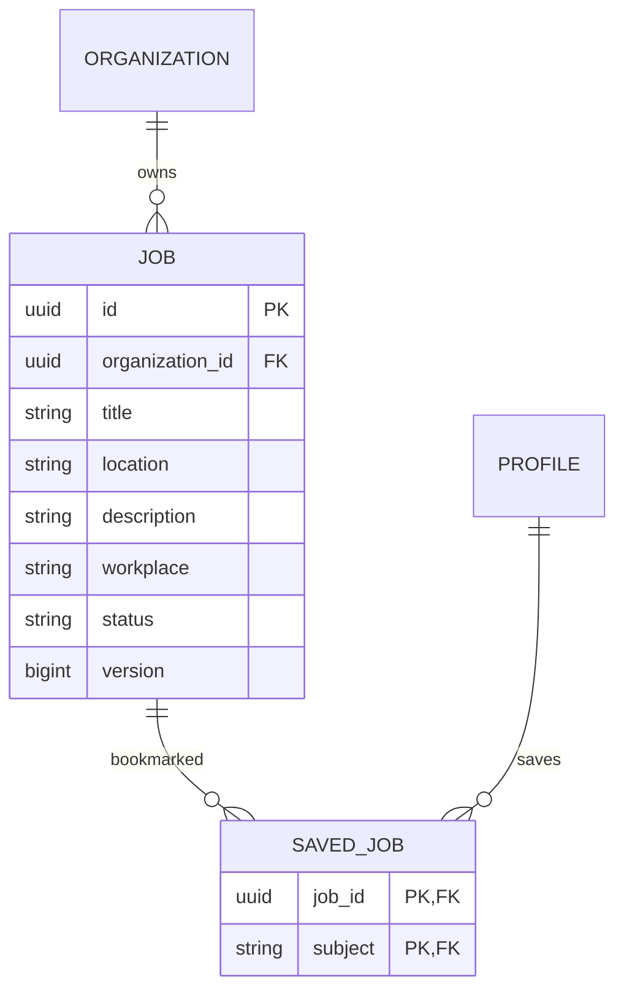
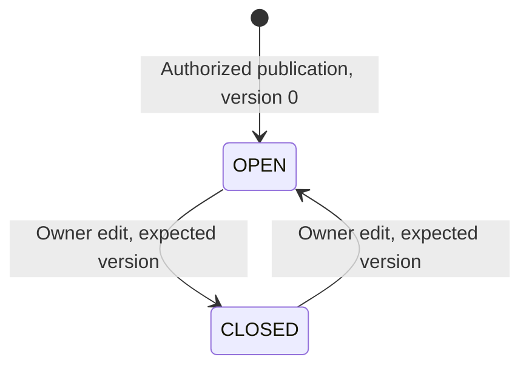

# Company-owned jobs: publication, discovery and bookmarks

## Requirements traceability

| ID | Source classification | Frontend / backend / contract | Status |
|---|---|---|---|
| INT-JOBS-001 | Explicit: job publishing and company ownership | Company Post a job link, /jobs/new, owner-authorized PUT /jobs/{id}, V22 | Integration verified |
| BE-JOBS-002 | Explicit: lifecycle, authorization, concurrency | Expected-version updates, immutable company ID, OPEN/CLOSED states | Integration tests |
| INT-JOBS-003 | Explicit: search and filtering | /jobs, literal title/company/location filters, workplace/company filters, keyset pagination | API/browser tests |
| INT-JOBS-004 | Explicit: saved jobs | Private idempotent bookmarks, Saved jobs list, persistence after closing | API/browser tests |
| FE-JOBS-005 | Observed: S05 hierarchy; explicit responsive/theme requirements | Compact sidebar, title/company/location rows, work arrangement and status, active Jobs navigation | Browser visual/accessibility checks |

This document describes the initial jobs slice. Profile-based applications are now integration verified in applications-slice.md; resume-based applications and matching remain pending. Source sections are backend requirements §14 and frontend requirements §8.6. S05 was inspected directly. The UI adopts its job-card hierarchy and compact sidebar with the established original Meridian design system. There are no copied company logos, promotions, personalized recommendation claims or fictional application confirmations.

## Actual architecture and contracts

The existing Spring application owns job transactions. V22 introduces job and saved_job. An organization FK ties every job to a company, and the company's authenticated owner is the publishing authority. This does not establish a verified recruiter identity or company membership. PostgreSQL is both source of truth and initial search implementation; no job-specific Kafka topic or OpenSearch projection is claimed.

`packages/contracts/profile.openapi.yaml` defines list/detail/publication/bookmark operations and generates TypeScript Job/JobWrite/JobPage types. The browser uses session-authenticated REST and CSRF-protected mutations. It never sees owner subjects or another member's bookmarks. Job IDs and company IDs are UUIDs; ownership cannot be set by request data. All reads are no-store and all endpoints require authentication.

## Lifecycle and consistency

Creation requires version 0 and status OPEN. A client-generated ID prevents duplicate creation: matching normalized retries by the authorized company owner return version 1; changed fields or a retry after a later edit return conflict. Organization ownership is checked under a row lock, the job's organization cannot change, and edits compare the expected version. Concurrent edits from one version have one winner. Closing and reopening are explicit owner edits, not destructive deletion.

OPEN discovery excludes closed jobs. SAVED and MANAGED retain closed jobs with an explicit status, and a known detail URL remains readable by authenticated members. Bookmarks persist until their member removes them. Saving is allowed for a closed job and never submits an application. Unique (job_id, subject) keys make repeated saves idempotent; removal scopes to the caller. FKs and text/state checks enforce database invariants.

Search is literal, case-insensitive title/company plus location matching. REMOTE/HYBRID/ONSITE and organization filters compose with the selected view before pagination. UUID-ascending pages contain at most twenty rows; they are not recommendations or newest-first ranking and do not provide snapshot isolation across concurrent changes. Profile privacy and personal block rules do not turn public-to-members company postings into private personal content; bookmark identities remain private.

## Frontend integration and failure behavior

Jobs navigation is active. Company owners reach publication from their company page; all members can view company-specific jobs and search the directory. The editor has required-field/length validation, pending state, confirmed persistence, cancellation, unsaved-navigation protection and version-conflict feedback. Server rules remain authoritative when controls are bypassed. Initial forms stay disabled until hydration/data initialization finishes.

Each request uses the existing ten-second bounded transport, including body consumption. The CSRF request and write have separate deadlines. Writes are not automatically retried. Creation retains its UUID while the page remains mounted. Aborted or obsolete list requests cannot replace a newer filter selection. Saved/detail/list values refresh from persisted API responses, with no mocked success. Views use explicit refresh/navigation, not live job push. Session rejection clears account/editor state and disables mutations. Drafts are memory-only and do not survive reload.

## Remaining requirements

Applications, resume uploads, application status/tracker, employer review, delegated recruiters, alerts, preferences, recommendation ranking/dismissal, salary/employment metadata, drafts/scheduling, deletion/retention, moderation/reporting, verified organizations, job publication events, search projections, quotas/rate limits, dedicated metrics and load testing remain pending. The detail page now supports profile-based applications with explicit sharing disclosure; resume upload remains unavailable. See applications-slice.md. The existing private HTTP metrics cover these endpoints, but there are no measured jobs latency SLOs or production-capacity claims. AWS deployment has not occurred.

## Verification

Executed `./scripts/container-up.sh --profile observability` successfully with V22. `./scripts/verify.sh` passed 60 backend invocations (56 profile/domain integration, three WebSocket handler, one Kafka/outbox integration), generated OpenAPI consistency, strict TypeScript and all twelve real-service Playwright journeys. After visual review, a separator token and form styling were corrected; the final containers rebuilt and both jobs and company browser journeys passed again. The light desktop jobs directory and dark mobile detail captures were visually reviewed; axe checks and mobile overflow checks passed. This is not full WCAG certification or performance evidence. Tests cover unauthorized publication, CSRF, creation rules and retries, company reassignment denial, stale/concurrent lifecycle writes, private/idempotent bookmarks, closed-job visibility and composed 21-job pagination. The real-service browser journey covers publication from a company page, refresh persistence, search, unauthorized mutation rejection, saving, closing, retained saved history, reopening, managed views, and desktop/mobile accessibility. External email is transported through local Mailpit; product/API successes are not mocked.

## Persistent job preferences

INT-JOBS-006 (explicit job preferences/persistent settings requirements) adds caller-private keyword, location and optional work-arrangement preferences through GET/PUT /me/job-preferences. V24 stores one row per profile with an optimistic version. GET returns unset version 0 defaults without creating a row; a version 0 write inserts once and later writes compare the current version. Concurrent inserts/updates have one winner. Writes require CSRF and an initialized profile. GET is no-store and cannot target another account.

INT-JOBS-007 (explicit preference-based job discovery requirement) adds PREFERRED to GET /jobs. PostgreSQL joins the authenticated caller's saved settings and applies literal case-insensitive title/company and location matching, plus REMOTE/HYBRID/ONSITE when selected. The predicate runs before pagination and combines with ad-hoc filters and optional company selection. Only OPEN jobs appear. Unset preferences produce no matches; explicitly saving all-empty criteria opts into all open jobs. This is transparent deterministic matching, not personalization/ranking or a claim of fit. It creates no alerts, advertising controls or public employment-preference disclosure.

The Jobs sidebar has a collapsible preference editor, save/cancel, reload and dirty-navigation protection. Confirmed settings refresh an active Preferred jobs list. Conflict feedback preserves the draft and requires reload rather than overwriting another session. Reload warns before discarding edits. Search filters and the preference form are separate: the main filters further narrow preferred results, and the UI states that composition. Existing saved-job and managed-job views are unaffected. No cross-session push is claimed; another session sees changes on explicit reload or a new preferred query.

Contract types are regenerated from OpenAPI. Tests cover caller isolation, validation/CSRF, initialization, normalization, nullable work arrangement, stale versions, eight concurrent inserts/updates, preference matching before 21-row pagination, closed-role exclusion and explicit-filter composition. A new real-Keycloak browser journey saves settings, signs into a second independent browser session, verifies persistence, changes settings there, rejects a stale first-session write, reloads and verifies changed matching results. Verification: `./scripts/container-up.sh --profile observability` succeeded with V24. The backend/contract/type stages of `./scripts/verify.sh` passed all 69 backend invocations (65 profile/domain integration, three WebSocket handler, one Kafka/outbox integration). Its first browser run exposed a color-only inline link in the company-filter notice. After adding an underline and rebuilding, the targeted jobs/preferences journeys passed, then a final `npx playwright test` passed all fourteen real-service journeys. The corrected light desktop/mobile preference captures were reviewed; axe and mobile overflow checks passed. Preference-specific dark-mode visual coverage remains pending. INT-JOBS-006 and INT-JOBS-007 are integration verified for deterministic matching and stored settings. Resume uploads and the other pending product/security/deployment work remain outstanding.

## Persistent dismissal and restoration

INT-JOBS-DISMISS-001 adds V33 `dismissed_job`, uniquely keyed by member/job. `PUT /jobs/{id}/dismissed` and `DELETE /jobs/{id}/dismissed` are caller-private, CSRF-protected, idempotent mutations. Discovery and preferred queries exclude dismissed roles before pagination; DISMISSED lists that member's dismissed roles, including closed jobs. Saved jobs, applications, management access and direct job details are unchanged. No recommendation algorithm is implied.

Job cards offer Dismiss and a Dismissed jobs view offers Restore. After server confirmation, the current query reloads; failures retain explicit recovery feedback. Another session sees the persisted preference on its next query. Backend checks cover caller isolation, retained saves/details, duplicates and restoration. The jobs browser journey dismisses, reloads, restores and continues through the existing save/application-related navigation.
