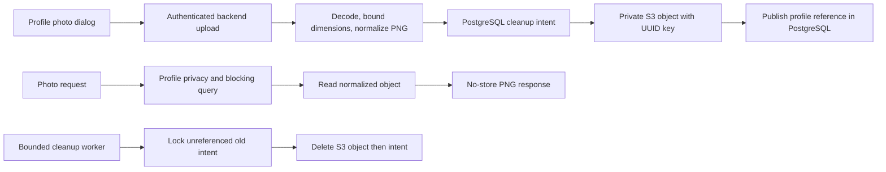

# Private media: LocalStack, Terraform and application integration

## Implemented scope

This increment connects the existing profile-photo frontend/API to private S3 object storage. It also supplies a reusable Terraform media module, a fixed-loopback LocalStack root, and an AWS root for the same bucket controls. It does **not** deploy the entire platform to AWS, emulate EKS/MSK/RDS, or complete mobile OTP, deletion, reposting or richer media formats.

`./scripts/localstack-up.sh --profile observability` starts the local S3 emulator, runs Terraform init/validate/apply, builds the application, and waits for health checks. The web application remains at `http://localhost:3100`. Terraform manages `meridian-local-media`, public-access blocking, enforced bucket ownership, AES-256 server-side encryption configuration, and incomplete-multipart cleanup. The AWS root additionally denies insecure transport and emits a backend workload policy restricted to Get/Put/Delete under `profiles/*`. It creates no IAM users, access keys, or public media URLs. Non-empty buckets are protected from automatic force deletion.

Local startup uses dummy credentials and hard-coded loopback Terraform endpoints. The backend reaches S3 on the internal Compose network. LocalStack's gateway is bound to host loopback, has no Docker-socket mount, and is not a public service. LocalStack remains a development tool; its local endpoint is not an authentication/security boundary against other programs on the same host.

## Versions and compatibility

Verified tooling is Terraform 1.17.0, HashiCorp AWS provider 6.69.1 (locked), AWS SDK for Java S3 2.57.8, and the already-installed LocalStack 4.10.0 image. The AWS SDK uses a singleton client, an eight-second total API deadline and three-second attempt deadline, following the official [endpoint configuration](https://docs.aws.amazon.com/sdk-for-java/latest/developer-guide/endpoint-config.html) and [timeout guidance](https://docs.aws.amazon.com/sdk-for-java/latest/developer-guide/best-practices.html).

The older LocalStack image is an explicit short-term local dependency. [Current LocalStack releases require an account/auth token](https://blog.localstack.cloud/localstack-single-image-next-steps/), which is not configured in this workspace. No license/authentication mechanism is bypassed. Upgrade and parity testing remain required before relying on the emulator as a production release gate.

## Actual storage and privacy flow



The upload contract is unchanged except for explicit storage-unavailable responses. Inputs remain JPEG/PNG up to 2 MiB, 4096 pixels per side and 16 megapixels; the backend produces PNG at most 512 pixels per side without source metadata. CSRF, owner scope, public/member privacy and blocking remain enforced by the existing API. The browser never receives an object key, signed URL, bucket credential or direct S3 URL.

V42 adds `profile_media_object` cleanup intents and `profile.photo_object_id`. Each upload commits its intent before attempting S3 PUT, then locks that intent and publishes the profile reference only after storage success. A failed PUT returns 503 and retains the previous image. Concurrent replacements remain last-successful-publication-wins. Missing storage on a referenced photo returns 503 rather than falsely reporting a successful upload or missing profile.

Removal clears the profile reference and any database image immediately. Replaced/failed/unreferenced object intents older than 15 minutes are collected in batches of ten per minute. A dedicated single-thread worker isolates storage deadlines from Kafka/realtime scheduling. It locks rows, performs idempotent S3 deletion, then removes the intent in one local database transaction; failures retain work for retry. Upload publication and local repair take the same intent lock, preventing attachment/restoration after successful collection. This is not a distributed transaction or an exactly-once claim. A storage server completing a request after all client deadlines and cleanup windows remains a reconciliation risk; a full storage inventory/reconciliation job is still pending.

Legacy database-backed photos remain readable and switch on replacement; there is no destructive bulk migration. Data export includes the normalized photo and excludes the internal object reference. Production S3 mode defaults to storing image bytes only in S3; disabling S3 while references remain causes explicit unavailability rather than silently deleting them.

## Local restart recovery: important emulator limitation

The executed restart probe demonstrated that LocalStack 4.10.0 in this setup loses its S3 bucket/objects on restart. Setting `PERSISTENCE=1` did **not** preserve them; that misleading configuration was removed. A mounted volume alone is not evidence of durable emulated S3.

The local Compose override therefore explicitly enables `MERIDIAN_MEDIA_S3_RETAIN_DB_COPY=true`. Successful local uploads retain their normalized image in the existing persistent PostgreSQL profile row as well as uploading to S3. After restarting LocalStack, run `./scripts/localstack-up.sh` to recreate bucket infrastructure. A subsequent authorized photo read restores a missing object from that local database copy. Repair is serialized with cleanup and counted separately. Export can also read/recover the owned photo. Network errors and missing bucket configuration still produce 503; they are not treated as missing-object recovery.

This is application-level recovery for the local emulator, **not native LocalStack persistence or an AWS backup design**. Production defaults to `retain-db-copy=false`. Removing a photo also removes its local recovery copy. PostgreSQL volumes must therefore be retained for local recovery. Previously existing S3 objects without a database copy cannot be reconstructed by this mechanism.

## Commands and operational boundaries

```sh
./scripts/localstack-up.sh --profile observability
./scripts/verify.sh
# Deliberately restarts the emulator: run separately from normal E2E tests.
./scripts/test-localstack.sh
terraform -chdir=infrastructure/terraform/localstack plan -detailed-exitcode -input=false
```

The operational browser test registers a fictional user with real Keycloak, uploads a photo, restarts LocalStack, reapplies Terraform, verifies exact restored image bytes and unchanged guest denial, and removes its photo. It then checks Terraform has no changes. The main browser suite is not allowed to run concurrently with this disruptive test.

To stop while preserving PostgreSQL:

```sh
docker compose --env-file .env -f infrastructure/local/compose.yml -f infrastructure/local/compose.media.yml --profile app --profile observability down
```

Do not add `-v` unless intentionally resetting all local data. Local Terraform state and provider caches are ignored; provider lock files are retained. After a reset, `localstack-up.sh` refreshes state and recreates missing emulated resources. The plain `container-up.sh` remains the database-photo development alternative; use the media override whenever existing S3 references need to be read.

Metrics: `meridian.media.uploads`, `meridian.media.failures`, `meridian.media.collected`, `meridian.media.cleanup.failures`, and `meridian.media.local.repairs`. They carry no per-user labels, file contents or keys. A persistent failure count needs inspection of storage reachability, bucket configuration and workload access; never expose SDK exception details to clients. Full alerting and storage SLOs remain pending.

## AWS preparation and remaining production work

`infrastructure/terraform/aws` requires an explicit account ID, region and globally unique bucket name, uses the normal credential/workload-identity chain, and restricts the provider to the chosen account. Its validated scope is the **media bucket only**. `terraform test` uses a mock AWS provider for offline plan/guardrail checks; these are not cloud deployment evidence. No real AWS apply has been executed.

Before an authorized AWS rollout, provision encrypted/locked remote Terraform state, workload roles with the emitted scoped policy, private networking/egress, application compute, production identity/database/Kafka services, TLS/secrets, storage retention/backup/restore, deployment/rollback controls and operational alarms. KMS-specific key policy, virus/CDR pipelines, document/video uploads and object inventory reconciliation remain open. Emulator configuration checks do not establish AWS enforcement, encryption-at-rest behavior or IAM isolation. No production-readiness claim is made.


## Verification history and CI

The first local restart probe failed because the older emulator did not retain S3 state; the final design explicitly uses the local PostgreSQL recovery copy described above. A later operational assertion was corrected to use the AWS CLI's paginated `Contents` output rather than an absent `KeyCount` field. The operational browser journey subsequently passed, including exact image bytes, guest denial and a no-change Terraform plan.

A full regression run exposed a five-second notification assertion failure while cleanup still shared Spring's default scheduler. Cleanup was isolated on a dedicated bounded worker; notification assertions were not relaxed. This is a scheduler-isolation correction, not evidence of a measured production latency SLO.

The workflow now installs Terraform, validates/tests the shared media module and offline AWS root, starts LocalStack-backed application services, runs the integrated suite, and separately runs restart recovery. These steps were executed locally as recorded in README; a hosted GitHub Actions run has not been performed in this workspace. Fresh isolated dependency startup/import/recreation and PostgreSQL persistence checks passed after the provider-logout networking update. The Keycloak realm uses the supported [environment placeholder mechanism](https://www.keycloak.org/server/importExport#_using_environment_variables_within_the_realm_configuration_files); container mode routes logout directly to the backend service.


Final executed checkpoint: `./scripts/localstack-up.sh --profile observability` and `./scripts/verify.sh` passed with 118 backend checks, generated OpenAPI consistency, strict TypeScript and all 33 standard Playwright journeys. `./scripts/test-localstack.sh` passed its separate real-service recovery journey. `terraform test` passed two shared-module guardrail runs and one offline AWS-root plan. `terraform validate` passed both roots; the operational test's final `plan -detailed-exitcode` returned zero. `./scripts/test-local.sh` passed fresh isolated realm import, container recreation/readiness and database persistence. All 42 database migrations applied. No real AWS deployment or hosted CI execution occurred.
