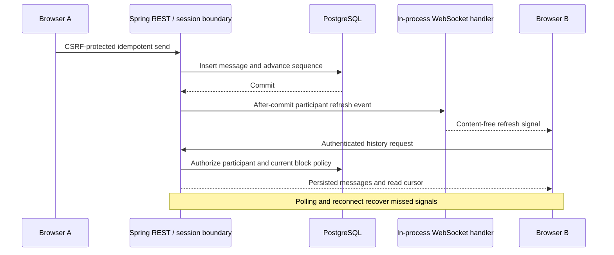

# Direct messaging slice

## Scope and contracts

The existing Spring application owns direct conversations and message persistence. Next.js proxies authenticated REST requests; the browser has no database/Kafka access. V19 adds direct_conversation and direct_message. No new deployment service is introduced.

| Requirement | Classification | Implementation | Contract | Evidence / status |
|---|---|---|---|---|
| INT-MSG-001 | Explicitly required by uploaded prompt | Start direct conversation from an accepted connection's profile | POST /conversations | Implemented; verification checkpoint in README |
| BE-MSG-002 | Explicitly required by uploaded prompt | Participant authorization, accepted-connection send policy, bilateral blocks | Conversation/message APIs | PostgreSQL tests |
| BE-MSG-003 | Explicitly required by uploaded prompt | Client UUID idempotency, per-conversation sequence, atomic persistence | PUT messages/{messageId} | Concurrent retry/order tests |
| INT-MSG-004 | Explicitly required by uploaded prompt | Durable history, unread count, monotonic read receipts | GET messages; PUT read | API and two-context browser tests |
| FE-MSG-005 | Observed from screenshot S04 / explicit prompt | Split-pane list/thread, composer, timestamps, responsive layout | Generated schemas | Accessibility/screenshots in browser journey |
| E2E-MSG-001 | Explicitly required by uploaded prompt | Two users send/receive/read, lose response, reconnect, block | Real Keycloak + PostgreSQL | Verification checkpoint in README |
| INT-MSG-006 | Explicitly required by uploaded prompt | Authenticated WebSocket refresh signals; durable REST recovery | /api/v1/realtime; refresh.v1.schema.json | Signals integration verified; explicit delivery acknowledgment pending |

Only accepted connections can start or send. A single canonical pair maps to one conversation; repeated creation returns its ID. This restrictive initial policy avoids opening unsolicited private messaging to arbitrary searchable members. Group conversations and configurable message-request policies remain pending.

Messages are immutable plain text, capped at 3,000 characters. Client UUIDs provide idempotency: matching normalized text/sender/conversation retries return the stored message; conflicting reuse returns 409. No attachments or message edit/delete is claimed.

## Transactions, ordering and privacy

Every send takes the shared member-pair advisory lock, then the conversation row lock, checks current connection/block permissions, inserts the message and advances the conversation sequence in one transaction. Connection transitions now also use the pair lock, establishing a consistent order with sends and blocks. The unique conversation/sequence constraint protects ordering independently of timestamps. There is no distributed transaction.

Read acknowledgment updates only the caller's participant cursor with greatest(previous, supplied). Future cursors are rejected. Acknowledgments are not proof that a human read the content; the UI acknowledges the latest fetched sequence while the selected document is visible. Unread counts are incoming messages after that cursor. The recipient cursor in history responses updates receipts for older messages already loaded by the sender.

Both participants may retrieve their history even after removing the connection, but cannot send again until reconnected. Blocking suppresses the conversation and history in both directions. Unblocking restores access to retained history, not the removed connection or sending permission. Counterpart names remain visible in participant-owned conversation history independently of profile-summary visibility. This is distinct from people-search disclosure.

Reads enforce authentication/participation and no-store. Writes require CSRF. Session-expiry responses clear displayed conversation history. Private bodies are neither published into Kafka nor explicitly logged by the application. Encryption at rest, retention/deletion, abuse review and production log validation remain deployment work; this is not end-to-end encrypted messaging.

## Delivery and recovery

The browser refreshes the active conversation and current conversation-list page every three seconds. Requests do not overlap; failures back off up to thirty seconds. Polling now complements WebSocket refresh signals described below. Other notification channels and durable messaging integration events are not implemented.

Latest history pages contain up to 50 messages in ascending sequence order; earlier pages use a before cursor. Refresh merges by message UUID and updates read receipts. If a disconnect creates a gap larger than one page, the UI resets to the latest page and exposes older-history pagination rather than silently joining a discontinuous history. Conversation pages contain twenty rows in newest-created order, not last-message activity order.

A failed send keeps its draft and UUID. Retrying unchanged text reuses that UUID; editing the draft chooses a new one. The UI warns before switching conversations or leaving with unsent text. Drafts are memory-only. A confirmed write clears the draft; failure feedback does not claim success. Polling errors retain previously delivered content unless access is denied, and reconnect retrieves authoritative persisted messages.

## Remaining scope

Explicit delivery acknowledgments, presence/typing, mute, attachments, group membership, unsent-draft persistence, notification integration, HTTP rate limits, message-storage quotas, retention/export/deletion and moderation remain planned. Conversation search, star/archive and WebSocket refresh signals are implemented in the checkpoints below. Polling capacity, payload/connection limits, server-side request deadlines, jitter, load tests, dedicated latency SLOs and production recovery exercises require further work. Existing HTTP metrics cover these REST endpoints; message-specific dashboards and traces are not complete.

Local containers and fictional test accounts are the verification target. No external deployment or production-readiness claim is made.

## Verified checkpoint

Executed `./scripts/container-up.sh --profile observability` and `./scripts/verify.sh`. Both application builds and healthy startup succeeded; 45 backend test invocations, generated OpenAPI consistency, strict TypeScript and all eight real-service Playwright journeys passed. The initial messaging browser run exposed an ambiguous alert locator; the corrected run passed in full.

Backend tests use real PostgreSQL and cover foreign-participant denial, CSRF, invalid text, repeated and conflicting message IDs, read-cursor monotonicity/future rejection, connection removal, bilateral block suppression, unblock history behavior, eight concurrent matching retries, fifty concurrent distinct sends with contiguous sequences, history pagination and block/send races.

The two-account browser test uses real Keycloak and PostgreSQL. It verifies the accepted-connection gate, unread arrival, receipt updates, a real committed send whose response is deliberately dropped, retry without duplication, offline/reconnect recovery, persisted history after reload and blocked-history removal. Only the explicit response-loss/offline failure cases alter transport. No mocked success is used.

Desktop/mobile screenshots were visually reviewed; axe checks and mobile overflow checks passed for the tested messaging states. The default/light layouts were captured; messaging-specific dark-mode visual verification remains pending. These checks do not establish complete WCAG conformance, performance SLOs or production readiness. INT-MSG-001 through FE-MSG-005 and E2E-MSG-001 are integration verified for the restricted direct-text/REST-polling scope. INT-MSG-006 remains planned.

## Request deadlines and session recovery

BEFORE this checkpoint, polling had failure backoff but an individual hung request could hold the refresh loop indefinitely. Messaging transport now applies a ten-second deadline to each request, including consumption of its response body. The CSRF-token request and the subsequent mutation each have their own deadline; this is not a single ten-second bound for the combined operation. Timers and external abort listeners are released on completion.

Conversation selection, list-page changes and component cleanup cancel the active refresh and invalidate its generation. A new selection can load without waiting for the prior network request. A late response cannot replace the new thread. Writes are never retried automatically: a timed-out send retains its draft and UUID, and the member explicitly retries after checking history.

A 401 from messaging transport clears the displayed thread, conversation list, selected conversation, read cursor, sender name and unsent draft, and stops automatic polling. The header offers sign-in again. This is client cleanup after authoritative backend session rejection, not a substitute for backend authorization.

INT-MSG-007 (explicit reliability/security requirements) covers bounded transport, stale-response isolation and session cleanup. Its test holds real backend responses to exercise deadline and cancellation behavior. The existing two-member test now holds a successfully committed send response until the client deadline, verifies receipt at the other member before retrying, then confirms no duplicate. A new three-account journey tests switching threads while a response is delayed, a history-request timeout followed by recovery, and real server-session revocation through the CSRF-protected logout endpoint. Fixture relationships in that new journey are initialized using real authenticated APIs.

These are browser request deadlines. Server/database dependency deadlines, jitter, WebSockets, broader load shedding and production capacity validation remain pending. Verification results are recorded in README.

INT-MSG-007 verification: Integration verified. The web image build/healthy startup and final `./scripts/verify.sh` passed with 45 backend invocations, generated-contract/type checks and all nine real-service browser journeys. The timeout tests do not substitute successful backend data: they delay responses from real committed/read operations. Session revocation is performed against the running backend, and a subsequent unauthenticated conversation request is verified to return 401.

## Participant-owned stars and archives

INT-MSG-008 (explicit prompt requirement) adds Star/Unstar, Archive/Restore, and Inbox/Starred/Archived filters. V20 stores separate booleans and preference versions for the two canonical participants. Conversation and message-history DTOs expose only the caller's preference, not the counterpart's.

PUT /conversations/{id}/preferences requires session authentication, CSRF, current participant access, no block, and the caller's expected preference version. The shared pair/conversation locks serialize preference writes with messages and blocks. Concurrent writes using the same version have one winner; stale attempts return 409 and require refresh. Starring/archiving does not change read cursors, connection permission or counterpart preferences.

INBOX excludes the caller's archived conversations. ARCHIVED includes them. STARRED includes the caller's starred conversations whether archived or not. Filters apply before twenty-row pagination, preserve newest-created ordering and reset the cursor when changed in the UI. Filtering changes the list; the selected thread and an unsent draft remain available. Stars/archive labels are textual and controls expose pressed state.

A newly inserted message atomically clears archive flags for both participants and increments only the preference versions whose archive state changed. Stars remain set. A replay of an existing message UUID does not restore the inbox or advance those versions. Consequently, a delayed send retry cannot undo a later archive action. Archive is organization, not deletion or mute.

The UI cancels any older refresh before saving settings and waits for server confirmation. Polling is held while that preference mutation is pending, then authoritative history/list data is refreshed. Errors leave the prior confirmed display; stale-version feedback requests a refresh. No optimistic success is shown.

Backend checks cover participant isolation, stale versions, eight concurrent writers, CSRF/null/foreign-participant rejection, filter behavior, block restrictions, retained unread counts, and the difference between new sends and replayed sends. The two-member browser journey covers star persistence, filtered lists, archive persistence, counterpart isolation, automatic inbox restoration, manual restore and unstar. Verification results appear in README.

This completes basic conversation organization for direct messages. Conversation search, mute/notification policy, bulk operations and activity-based sorting remain planned. WebSocket delivery and the other messaging backlog are unchanged.

INT-MSG-008 status: Integration verified. Container builds/healthy startup with V20 and the final verify script passed: 47 backend test invocations, generated-contract/type checks, and all nine real-service browser journeys. Updated messaging axe and mobile overflow checks passed, and the mobile capture was visually reviewed. No mocked success responses or production deployment are claimed.

## Conversation-name search

INT-MSG-009 (explicit messaging search requirement) adds a name-search form to the conversation list. GET /conversations accepts optional q, trimmed to at most 120 characters. Empty input lists all conversations in the chosen view. Matching is a case-insensitive literal substring of the counterpart's current name; percent and underscore characters are not wildcards. Message bodies, email addresses and other profile fields are not searched.

The query is bound as a SQL parameter and combines with participant, bilateral-block and per-participant view predicates before pagination. It cannot discover conversations belonging to other members. Existing participant-history disclosure rules apply even if the counterpart's profile summary is private; this is not public people search. Results retain newest-created ordering and twenty-row keyset pages, not relevance ranking.

Submitting or clearing a query cancels the obsolete refresh and resets the list cursor. The selected thread and unsent draft are retained because search only filters the list. The query remains active across Inbox/Starred/Archived changes and periodic refresh. Search input is transient UI state, reset on page reload; no search history is stored. Query changes show a loading state before empty-result feedback.

Tests use 21 real persisted conversations to check pagination/filter composition, case and whitespace normalization, literal special characters, private-body exclusion, outsider isolation, blocks and query bounds. Browser checks use real authenticated services and verify matching/no-match/clear states, view composition and preservation of the active draft.

This implements conversation-name search only. Message-content search, linguistic ranking, query history, activity sorting and large-scale query-plan/load validation remain pending. Verification results are recorded in README.

INT-MSG-009 status: Integration verified. Container builds/healthy startup and final `./scripts/verify.sh` passed with 48 backend invocations, generated-contract/type checks and all nine real-service browser journeys. Updated messaging accessibility/overflow checks passed, and the mobile capture was visually reviewed. No production performance or external deployment is claimed.

## Authenticated live refresh signals

INT-MSG-006 now provides WebSocket update signals at `/api/v1/realtime`. The existing Spring deployment owns the socket and the HTTP session. The handshake requires an authenticated OIDC session and an exact configured `Origin`; missing and foreign origins are rejected. The browser never receives tokens in JavaScript. Incoming text commands are unsupported; all writes continue through CSRF-protected REST.

After a successful transaction commits, in-process events notify the affected participants about conversation creation, new messages, read receipts, connection/block changes and private conversation preferences. Preferences notify only their owner. The versioned frame is exactly `{"version":1,"type":"refresh"}`; it contains no identifiers, private bodies, credentials or event details. The client retrieves authorized state from REST on connection, signal and reconnect. These hints are deliberately lossy: bounded queue overflow drops hints, and three-second polling (with failure backoff) recovers authoritative state. They are not durable Kafka messages or delivery acknowledgments. A send response still means database persistence, not receipt by the counterpart.

The server permits at most five sockets per identity and 1,000 sockets per instance. Two delivery threads and a queue of 256 bound queued work; socket decorators serialize writes with an 8 KiB buffer and a one-second configured send limit. These settings are safeguards, not a measured guarantee against every slow-client behavior. Sessions are rechecked before each signal and every five seconds; invalidated, expired or mismatched sessions are closed. Shutdown closes active sockets. Metrics expose active connections, sent signals and dropped work through the existing private management endpoint.

The browser reconnects with exponential delay (one to thirty seconds) and jitter. A rejected REST session stops the socket and clears private UI state. Polling remains available during socket failure. Current transport is single-instance: cross-replica fan-out, shared sessions, load testing, keepalive policy and production proxy timeout tuning remain pending. No exactly-once claim is made.

Local Compose sets `REALTIME_ORIGIN=http://localhost:3100` and builds the web client with `NEXT_PUBLIC_REALTIME_URL=ws://localhost:8081/api/v1/realtime`. Development ports share the localhost session cookie. Production requires an HTTPS origin, WSS URL and reverse-proxy WebSocket upgrade support; neither public exposure nor AWS deployment has been performed. The compiled public URL must be set at web build time. With no explicit URL, non-localhost clients use the current host's `/api/v1/realtime` path, which requires that proxy configuration.

Implementation follows Spring's [WebSocket server guidance](https://docs.spring.io/spring-framework/reference/web/websocket/server.html) and [transaction-bound event model](https://docs.spring.io/spring-framework/reference/data-access/transaction/event.html). Framework versions remain managed by the existing Spring Boot dependency set.

Verification: `./scripts/container-up.sh --profile observability` succeeded. `./scripts/verify.sh` passed 51 backend invocations, generated OpenAPI consistency, strict TypeScript, and all nine real-service browser journeys. A subsequently added targeted PostgreSQL-backed test, `ProfileIntegrationTest#realtimeSignalsRequireCommittedTransactions`, also passed, proving rollback suppresses signals while commit delivers them (52 distinct backend cases checked across these runs). Unit checks cover recipient isolation, minimal payloads, invalidated sessions and subject mismatch. Browser checks cover real authenticated delivery, wrong-origin and anonymous handshake rejection, offline/reconnect and logout cleanup. Messaging axe and mobile overflow checks passed; the updated light mobile capture was visually reviewed. There was no AWS deployment, performance certification or complete-platform readiness assessment.
