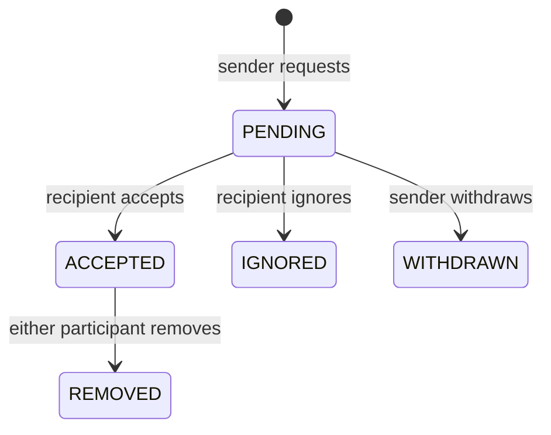

# Network slice

| Requirement | Source classification | Implementation | Evidence | Status |
|---|---|---|---|---|
| INT-NETWORK-001 | Explicitly required by uploaded prompt | Send invitation from opted-in member summary; pending request list | Two real accounts, browser UI | Integration verified |
| INT-NETWORK-002 | Explicitly required by uploaded prompt | Recipient accepts, both members see connection count | Browser journey and API tests | Integration verified |
| INT-NETWORK-003 | Explicitly required by uploaded prompt | Ignore, withdraw and remove | Browser journey | Integration verified |
| BE-NETWORK-004 | Explicitly required by uploaded prompt | No self-request; unique active unordered pair; participant authorization; expected version | PostgreSQL API tests and constraints | Integration verified |

The database stores a single accepted relationship, not two independently mutable directed rows. Counts derive from accepted rows for the current participant. Historical terminal rows remain stored but are excluded from current network responses. A new request is allowed after a terminal state; there is no cooldown yet. Every transition atomically checks source state, version and actor. Authorized retries of the immediately completed transition version return 204 without duplicate effects; retries after a later state advancement still return 409.

Only opted-in member summaries can receive new invitations. Participants can see the counterpart name in their own pending/accepted relationship even if summary sharing is subsequently disabled; summary-body access still follows visibility settings. Internal subject identifiers are not returned by the network API.

Remaining: invitation rate limits/cooldowns, following, mutual connections, discovery/suggestions, pagination, notifications, transactional outbox/Kafka publication, live updates, request replay semantics, graph-scale performance and standalone network layout. The overall network module is incomplete. Changes in another browser require Reload network; no real-time notification delivery is claimed.

## Member blocking checkpoint

| Requirement | Source classification | Implementation | Evidence | Status |
|---|---|---|---|---|
| INT-NETWORK-005 | Explicitly required by uploaded prompt | Block from shared profile; list and unblock owned blocks | Two-account real-service Playwright journey | Integration verified |
| BE-NETWORK-006 | Explicitly required by uploaded prompt | Bidirectional summary/invitation denial; close active relationships atomically | PostgreSQL tests for pending and accepted states | Integration verified |
| BE-NETWORK-007 | Recommended implementation detail | Pair-scoped transaction advisory lock serializes invitation creation with block changes | Implementation review; concurrent block/invitation stress test pending | Implemented |

V11 stores directed blocks keyed by blocker and blocked profile subjects. APIs expose only public UUIDs. Blocking and relationship closure commit in the same PostgreSQL transaction. A pending invitation becomes IGNORED; an accepted relationship becomes REMOVED. Existing state/version checks prevent a stale acceptance from restoring a closed relationship. Repeated blocking is idempotent; unblocking only removes the authenticated caller's directed block and never restores a relationship. A member can block an opted-in profile or a counterpart with relationship history. Self-blocking is rejected.

`GET /api/v1/blocks`, `POST /api/v1/blocks` and `DELETE /api/v1/blocks/{id}` are defined in the OpenAPI contract. Mutations require session authentication and CSRF. Profile summaries check blocks in both directions on every read. The block list retains the counterpart name for management; it does not disclose their summary. Previously delivered information cannot be retracted. Other browser sessions must refresh to see changed state.

Verification: `bash scripts/verify.sh` passed with 24 PostgreSQL-backed test invocations, generated-contract verification, strict TypeScript and all 3 real-service browser tests. Tests cover CSRF, self-block rejection, duplicate blocking, both-direction denial, relationship closure, stale acceptance, ownership of unblock, and no relationship restoration. `npm run build` in `apps/web` passed. API tests use injected OIDC principals; browser tests use real local Keycloak, PostgreSQL and Mailpit.

Future feed, search and messaging implementations must enforce blocking as well; those modules do not exist yet. Event publication, audit records, rate limits and live synchronization remain pending. This checkpoint does not establish overall platform production readiness.

## Following checkpoint

| Requirement | Source classification | Frontend | Backend / contract | Evidence | Status |
|---|---|---|---|---|---|
| INT-NETWORK-008 | Explicitly required by uploaded prompt | Follow/Unfollow on member profile; private Following list | FollowController; GET/PUT following/{id}; GET following | following.spec.ts, PostgreSQL API tests | Integration verified |
| BE-NETWORK-009 | Explicitly required by uploaded prompt | Confirmed state and reload after failure | Desired-state idempotency, composite unique key, self-follow ban | Eight concurrent retries; CSRF/anonymous/validation checks | Integration verified |
| BE-NETWORK-010 | Explicitly required by uploaded prompt | Mask private target name; allow removal | V17, current visibility filtering, bilateral block cleanup | Private-target test, concurrent follow/block test | Integration verified |
| FE-NETWORK-011 | Explicitly required by uploaded prompt | Loading/error/empty states, paginated list and count | Generated OpenAPI types; 20-item keyset pages | Pagination API test; transport-failure browser check | Integration verified |

A follow is a directed relationship independent of invitations or accepted connections. V17 stores one row per follower/followed pair with a unique ordering sequence. Repeated desired-state writes do not duplicate relationships. Concurrent Follow and Unfollow operations serialize; the last transaction acquiring the pair lock determines state. No expected-version contract is claimed for these desired-state operations.

New follows require a shared member summary and an initialized caller profile. The Following list belongs exclusively to the caller, exposes no other member's following list, and masks names/links when a target makes their summary private. Existing follows remain removable after privacy changes. This is a deliberate privacy policy, not a public follower count feature.

Follow writes and blocks share the existing pair-scoped transaction lock. Blocking deletes both directed follows in the same transaction as block insertion and connection closure. A block therefore prevents a concurrent follow from restoring the relationship. Target visibility is locked during follow creation. Unblocking never recreates follows. Responses are backend-confirmed; uncertain transport outcomes instruct the user to refresh. Other tabs need a reload.

Verification: 38 backend invocations passed (37 profile/network/feed tests plus the Kafka event integration test), generated OpenAPI consistency and TypeScript passed, and the six real-service browser journeys passed across the regression run and corrected targeted rerun. The new browser test uses real Keycloak/PostgreSQL; its single deliberately aborted PUT exercises failure feedback and is not used as success evidence. Member-page axe checks passed. Container build/startup applied V17 successfully.

Following does not yet change feed ranking/filtering, publish events or generate notifications. Public follower counts, follower visibility controls, follow rate limits, discovery, mutual connections and live synchronization remain planned. Existing connection-acceptance notifications/outbox are implemented in the prior event slice; earlier checkpoint backlog statements above are historical.

Following-feed follow-up: the chronological Following view is now implemented and integration verified; see INT-FEED-009 in feed-slice.md. Earlier statements that follows do not affect feed filtering describe the previous checkpoint. Follow notifications and ranked recommendations remain planned.

## Dedicated screenshot-driven network page

The top My Network tab now opens /network with an active navigation indicator. Layout follows the supplied Screenshot 2026-11-01 at 12.52.53 AM reference: management sidebar, Grow navigation and a bordered invitation list with aligned actions. All counts and invitation names come from the authenticated network API. Existing profile network controls remain compatible.

The page supports incoming accept/ignore, sent withdrawal, connection removal, name filtering, explicit refresh, existing following management and links to company pages/people discovery. Reads and writes use bounded authenticated requests; session rejection clears network/account data. No fixture relationships, mutual counts, user photos or advertisements were copied. Catch up, groups, events and newsletters are explicitly unavailable. Followers listing, mutual connections and ranked suggestions remain backlog.

Verified TypeScript, rebuilt healthy local containers and a two-user real-service browser journey covering top navigation, acceptance, persisted connection counts after reload, filtering and removal. Desktop/mobile dark axe and overflow checks passed; both screenshots were visually inspected against the reference. Full regression suites were not rerun in this increment.

## Consented discovery, mutual connections and followers

The Network sidebar includes an owner-only Followers view alongside Following. Lists use the existing persisted social graph, 20-item cursor pagination and current bilateral-block filtering. A follower whose member profile is private is labeled “Private member” with no profile link; follower lists and totals are not published to other accounts.

Suggested-member cards show profiles that opted into member visibility and discovery, excluding the viewer, bilateral blocks, accepted connections and pending invitations. Their profile links lead to the existing functional Connect/Follow actions. Suggestions use public-ID ordering; this is transparent directory discovery, not a relevance-ranking or machine-learning implementation.

V35 adds `connections_visible=false` and an independent concurrency version to profiles. Settings → Visibility → Connection sharing controls this opt-in through `/me/network-privacy`. The server validates ownership, CSRF and expected version. A stale update returns 409 and the UI requires reload rather than overwriting a newer preference. The preference is included in existing business-data exports through the owner profile projection.

Mutual lists and suggestion counts disclose only relationships involving consenting, member-visible, discoverable intermediate profiles. The target must also consent and remain discoverable/member-visible. A block between the viewer and target denies the target; a block between an intermediate and either party excludes that intermediate. All graph/consent checks occur in the read query. Connection removal or consent withdrawal affects subsequent reads immediately; previously delivered data cannot be retracted. The caller's full graph is never published by this endpoint.

REST contracts: `getNetworkPrivacy`, `setNetworkPrivacy`, `getNetworkSuggestions`, `getMutualConnections`, `listMyFollowers`. Responses are no-store and require authenticated sessions. Pagination resets on refresh; the client cancels obsolete reads, guards against stale responses, has bounded transport deadlines and displays retry/empty/unavailable states. New filtered indexes support accepted graph traversal and follower pagination; graph-scale performance remains unmeasured.

Backend coverage checks default denial, null/CSRF/stale preference rejection, consent withdrawal, relationship removal, bilateral blocks, anonymous denial, active-invitation/connection exclusion, private follower redaction, owner isolation and follower pagination. The three-account browser journey connects two people through a mutual member, verifies consent persistence and withdrawal, follows a member, opens the private follower list, discovers a suggestion and sends an invitation from its real profile. Responsive dark-mode axe/overflow and screenshot checks accompany the journey. See README for the final executed suite status.

Remaining network work includes Catch up milestones, groups/events/newsletters, ranked suggestions, broader relationship-visibility policies, invitation throttling and high-volume graph benchmarks. No AWS resource or separate graph service was introduced.

## Lost-response and concurrent retry recovery

The browser retains one UUID for a Connect attempt across failures. The backend recognizes the same UUID/sender/recipient as a completed invitation request and returns 204 without recreating the relationship, even if its lifecycle has advanced. Current blocks still deny the request. Changing the UUID for an active pair, reusing another sender's UUID or changing the recipient conflicts.

Transition retries retain the expected version. The pair-scoped transaction lock serializes concurrent requests. Only the authorized actor may replay the immediately completed action/version; returning 204 does not increment the version or publish another outbox event. A later state change invalidates the old transition retry. Simultaneous acceptance tests assert two successful responses, one version increment and one outbox record.

The browser failure test allows the first real POST to commit, discards its transport response, and retries from the same Connect control. It asserts the same UUID is reused and the invitation can be accepted once. External transport failure is injected only for this negative path; successful persistence and retry use real services.
