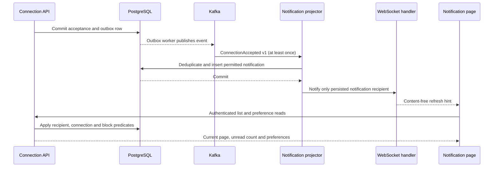

# Notifications: durable projection and live synchronization

The application-notification extension below supersedes the initial connection-only scope. Both categories use the existing PostgreSQL/Kafka worker and shared authenticated notification UI.

## Scope and traceability

| Requirement | Source classification | Frontend / backend / contract | Status |
|---|---|---|---|
| INT-NOTIFY-001 | Explicitly required by uploaded prompt | Kafka connection-acceptance projection, PostgreSQL deduplication, authenticated notification list | Implemented; existing event integration coverage |
| INT-NOTIFY-002 | Explicitly required by uploaded prompt | Read state and versioned connection preference, synchronized across tabs | Integration verified |
| INT-NOTIFY-003 | Explicitly required by uploaded prompt | After-commit WebSocket refresh hints with REST recovery | Integration verified |
| FE-NOTIFY-004 | Observed from screenshots S03/S12 | Notification cards, unread labels, account sidebar and preference panel | Implemented for connection notifications only |
| INT-NOTIFY-005 | Explicit reliability/security requirements | Request deadlines, offline recovery, revoked-session cleanup | Integration verified |

Authoritative REST contracts remain in `packages/contracts/profile.openapi.yaml`; the generated TypeScript schemas are consumed by the page. The shared frame contract is `packages/contracts/realtime/refresh.v1.schema.json`. No schema migration or additional service is required for this increment.

## Actual flow

The projector signals only when it inserts a notification. Redelivery, disabled preferences, blocked relationships and invalid source state do not produce a new projection signal. The existing Kafka retry/DLQ and outbox behavior is unchanged. Signals are transaction-bound; rollback does not dispatch them. Read and preference mutations signal only the caller after commit. Existing connection/block signals also prompt a refresh so invalid targets disappear from displayed lists.

The frontend shares the authenticated socket/reconnect implementation with messaging. A signal never changes business data directly: it prompts authorized REST reads. Three-second polling recovers dropped signals; failures back off up to thirty seconds. Each HTTP request has a ten-second deadline, including response-body consumption. No write is automatically retried. Mark-read is idempotent, and preference writes use a version so stale writes return conflict rather than silently overwriting another tab.

The list shows twenty rows per cursor page. Older/Newest navigation replaces the displayed page; live refresh retains that page's cursor. Unread count covers all currently visible notifications, not only that page. A notice on older pages directs members to newest arrivals. This avoids jumping to the top whenever an unrelated live event occurs. Paging cancels obsolete requests and uses a generation check to prevent stale responses from replacing the new page.

After an authoritative 401, the page clears notification items, actor/account names, preferences, cursors and unread count; it stops polling/reconnecting and disables mutation controls. A transient transport failure preserves previously confirmed data with retry feedback. Server authorization remains authoritative for every fetch and mutation.

## Deployment and remaining scope

This reuses the existing single-instance socket transport, local origin configuration, connection limits and private management metrics documented in `messaging-slice.md`. Sockets provide lossy hints, not durable delivery acknowledgments. PostgreSQL and authorized REST are the recovery source. Shared sessions and cross-replica fan-out remain prerequisites for scaling this transport beyond one backend instance.

Only connection-acceptance notifications exist. Jobs, mentions, posts, message notifications, category filters, email/push delivery, global navigation badges, granular channel preferences and notification retention remain pending. No performance SLO, complete WCAG conformance or production-readiness claim is made. AWS deployment has not occurred.

## Verification

Executed `./scripts/container-up.sh --profile observability` and `./scripts/verify.sh`: both application builds and health checks passed; 53 backend invocations (49 profile/domain integration, three WebSocket handler, one Kafka/outbox integration), generated OpenAPI consistency, strict TypeScript and all ten real-service Playwright journeys passed. Notification desktop/mobile axe and mobile overflow checks passed; the updated light mobile screenshot was visually reviewed. Notification-specific dark-mode visual verification remains pending. Tests include a real PostgreSQL projection check for audience, replay, disabled preferences and blocks; the existing Kafka redelivery/outage test; real browser connection acceptance while the notification page is already open; cross-tab read/preference synchronization; removal after disconnecting; request timeout and recovery; offline/reconnect; and backend logout cleanup. Only explicitly injected transport failure cases delay a real backend response. External verification email uses local Mailpit.

## Durable application updates (V27)

| Requirement | Classification | Frontend / backend / contract |
|---|---|---|
| INT-NOTIFY-006 | Explicit application events and notifications | Application audit + outbox → ApplicationChanged v1 → authorized job notification |
| FE-NOTIFY-007 | Screenshot S03/S12 category hierarchy; explicit filtering | All, Network and Jobs filters, context link, read state |
| INT-NOTIFY-008 | Explicit persisted notification preferences | Job application checkbox, shared optimistic version, projection-time suppression |

Each committed application submission/review/withdrawal now inserts an outbox row referencing its immutable application_audit version. V27 adds mutually exclusive connection/application sources, audit foreign keys and unique application/version constraints on both outbox and notification. Failed transitions and duplicate submissions do not produce another event. Existing pre-V27 transitions are not backfilled.

ApplicationChanged v1 carries only eventId, schemaVersion, type, applicationId and applicationVersion, keyed by application ID on meridian.applications.v1. It excludes names, contact data, statements and resumes. The publisher holds a later application version until earlier unpublished versions have been acknowledged. A crash around acknowledgment can still cause redelivery; there is no exactly-once transport claim. Consumer deduplication and notification insertion commit before Kafka offsets.

The projector requires an event ID/application/version matching the authoritative outbox and audit. It derives the audience from business state: the company owner receives SUBMITTED and WITHDRAWN; the applicant receives REVIEWING, ACCEPTED and REJECTED. Active recruiters can still review applications, but recruiter notification fan-out is not implemented. Application inbox entries retain historical transition status/version and current company/job labels; the UI explicitly directs readers to the application for its current status. No applicant statement, resume or reviewer identity is exposed in notification data.

GET /notifications accepts category=ALL|NETWORK|JOBS and applies the category before keyset pagination. unreadCount remains global across all currently authorized categories. Personal blocks suppress connection notifications; they do not override explicit application/business access. The context link opens the appropriate applicant or received-application tracker for that job. Read marking is idempotent and survives reloads.

The jobs preference defaults true and shares the existing preference version with connections. Older clients may omit jobs without overwriting it. Opt-out is evaluated when a notification is projected; the event is consumed without future backfill. Previously delivered rows remain. Stale writes conflict rather than changing another session's setting.

Malformed application envelopes are acknowledged only after a diagnostic is written to meridian.applications.v1.dlq. That diagnostic contains source topic, partition, offset and a fixed error code, never the untrusted payload or key. Canonical outbox/audit data is the repair source. Valid envelopes with no canonical source are ignored. The existing connection DLQ behavior is unchanged.

Validation includes real Kafka replay and redacted quarantine, actual projection-time opt-out, immutable status snapshots, caller isolation, source validation, safe retry counts and preference compatibility. A real Keycloak browser journey exercises submission notification, owner context navigation, review notification, category/global-unread behavior, mark-read persistence and persisted job opt-out. Final executed counts and visual results are recorded in README.

Remaining work: recruiter fan-out, email/push channels, other categories, notification retention, replay/rebuild tooling, multi-replica socket fan-out, dedicated lag/tracing coverage, restart/load drills and production deployment. The local broker still has one replica and seven-day topic retention; a broker outage after startup delays delivery while database-backed application writes remain available.

## Read/unread, all-read and dismissal

INT-NOTIFY-LIFECYCLE-001 adds owner-scoped `DELETE /notifications/{id}/read`, `PUT /notifications/read` and `DELETE /notifications/{id}`. Existing mark-read remains compatible. Mutations require session/CSRF and publish post-commit realtime refresh hints. Last committed individual read/unread action wins. All-read takes the `readThrough` string from a list response and affects only visible notices at or below that sequence across all categories, leaving later deliveries unread. Invalid/overflow boundaries are rejected.

V32 stores `dismissed_at`. Dismissed rows remain as event-identity tombstones, so replay cannot recreate them; lists/counts exclude them. Repeat dismissal succeeds for the owner; foreign/absent IDs return 404. Read/unread of dismissed IDs is unavailable. The UI offers Mark read/Mark unread, Mark all read, and confirmed Dismiss, with server-confirmed refresh and no optimistic false success.

Backend tests verify ownership, CSRF, invalid boundaries, retry idempotency, newer arrival preservation and replay after dismissal. The real Kafka/application-notification journey verifies read/unread persistence, all-read, canceled dismissal, confirmed dismissal and reload.
