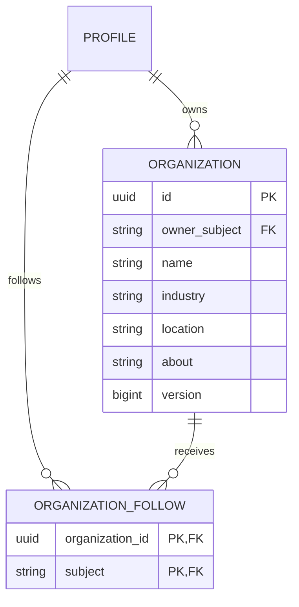

# Organization pages vertical slice

## Requirements and implemented boundaries

| ID | Source | Frontend | Backend/data | Contract | Evidence/status |
|---|---|---|---|---|---|
| INT-ORG-001 | Explicit: backend company creation/updates; frontend company overview | /companies/new and /companies/{id} | Owner derived from OIDC subject; organization V21 | PUT/GET /organizations/{id} | Integration verified |
| BE-ORG-002 | Explicit: prevent unauthorized company management | Owner-only editor | Owner authorization, expected versions, creation retries | OrganizationWrite | Ownership/concurrency integration tests |
| INT-ORG-003 | Explicit: company followers | Follow/unfollow and Followed companies | Private caller relationship, unique primary key | PUT/DELETE /organizations/{id}/follow | API and two-account browser tests |
| INT-ORG-004 | Explicit: company search | Directory, query, managed/followed views | PostgreSQL literal search and UUID keyset pages | GET /organizations | Contract generation, 21-row pagination test |
| FE-ORG-005 | Recommended implementation detail using existing reference-derived design system | Profile hero, overview cards, sidebar, responsive themes | No independent backend authority | Generated Organization types | Browser visual/accessibility checks |

Source requirements: `backend-functional-requirement.md` organizations section (lines 901–919) and `frontend-functional-requirement.md` company pages section (lines 706 onward). No supplied screenshot directly establishes a company-page layout; this page reuses the existing reference-inspired header, profile hero, cards, spacing and theme tokens. No LinkedIn logo, real customer data or copied company imagery is introduced.

The existing Spring deployment owns this bounded context and PostgreSQL is authoritative. It is not a new microservice. V21 creates organization and organization_follow, with owner/member profile foreign keys, immutable UUID identity, positive optimistic version, bounded text columns, owner indexes and unique follows. There is no company membership or employment-verification inference.

## Authorization and persistence

All endpoints require the existing OIDC session; writes require CSRF. Creating a company requires an initialized profile and sets owner_subject from the authenticated principal. Ownership is neither accepted from the request nor transferable through this API. All signed-in members can read company pages, independent of personal profile visibility. Pages explicitly state that they are member-created and unverified; this is not proof of brand authority.

Creation uses a client UUID and version 0. Repeating the same normalized initial fields under the same owner returns version 1 without another insert. Different payloads, another owner or a retry after a later edit return conflict. Updates lock the company row and compare the expected version; only one concurrent writer at that version succeeds. No distributed transaction is used.

Follows use a unique (organization_id, subject) key. Repeated follow/unfollow requests have idempotent effects. Unfollow affects only the caller. Aggregate follower counts are visible; follower identities and owner identity are absent from response DTOs. The owner may follow their own company. Organizations are separate public-to-members entities; personal blocks do not hide these company pages or expose follower identities. Moderation/takedown and delegated administrators are still required before a broader production launch.

Directory queries match literal, case-insensitive substrings of name or industry; `%` and `_` are literal characters, not wildcard syntax. ALL, MANAGED and FOLLOWING are filtered server-side before pagination. Results use UUID ascending order, twenty rows per page, and no-store. This is neither ranked search nor a snapshot guarantee during concurrent inserts. PostgreSQL search avoids an unnecessary projection for this first slice; OpenSearch indexing and company integration events remain pending.

## Frontend behavior

The account menu and people-search sidebar link to Companies. Members can create a page, edit its name/industry/location/about, cancel edits, and refresh persisted state. Dirty forms prompt before cancellation or browser navigation. A conflict preserves the draft and directs the owner to cancel and refresh before retrying. The creation UUID survives a failed request within the current page; drafts and retry IDs do not survive a full reload.

Each HTTP request has a ten-second deadline covering headers and body. Reads use abort/generation guards; obsolete responses cannot replace a newly selected directory query. Mutations wait for confirmation and are never automatically retried. Company views are explicitly refreshed and reloaded; this slice does not claim live company update push. Session rejection clears the active page's private account/editor state and disables writes. Backend authorization independently applies on every request.

The generated OpenAPI types are authoritative for directory, detail and editor models. No mock company success response or seeded company fixture powers the product UI. End-to-end fixtures are fictional and created through actual user workflows.

## Remaining scope

Additional administrators and granular roles, administrator invitations/transfer, organization members, verified employment, company verification, logos/banner uploads, web links, organization deletion/export/retention, posts, jobs, recruiter permissions, company inboxes, abuse-reporting/takedown, quotas/rate limits, indexing/events and performance validation remain planned. Jobs publication/discovery/saving is now integration verified and the Jobs navigation is active; applications and recruiter delegation remain pending. See jobs-slice.md. No AWS deployment or production-readiness claim is made.

## Verification

Executed `./scripts/container-up.sh --profile observability` successfully with V21. The final `./scripts/verify.sh` passed 57 backend invocations (53 profile/domain integration, three WebSocket handler, one Kafka/outbox integration), generated OpenAPI consistency, strict TypeScript and all eleven real-service browser journeys. The company journey also passed in isolation. Initial browser runs exposed editable fields before hydration and test locator/result-wait issues; these were corrected before the final passing run. Company light-desktop and dark-mobile screenshots were visually reviewed, and axe/mobile overflow checks passed. These checks are not full WCAG certification or load-test evidence. Backend coverage targets owner isolation, CSRF/authentication, initialization, required/length validation, exact creation retry, stale edits, concurrent creation and updates, follow isolation/idempotency, missing companies and literal paginated search. The browser journey covers create/refresh/edit/cancel, a real concurrent-write conflict, unauthorized mutation denial, discovery/follow persistence, managed/followed views and light desktop/dark mobile accessibility.
