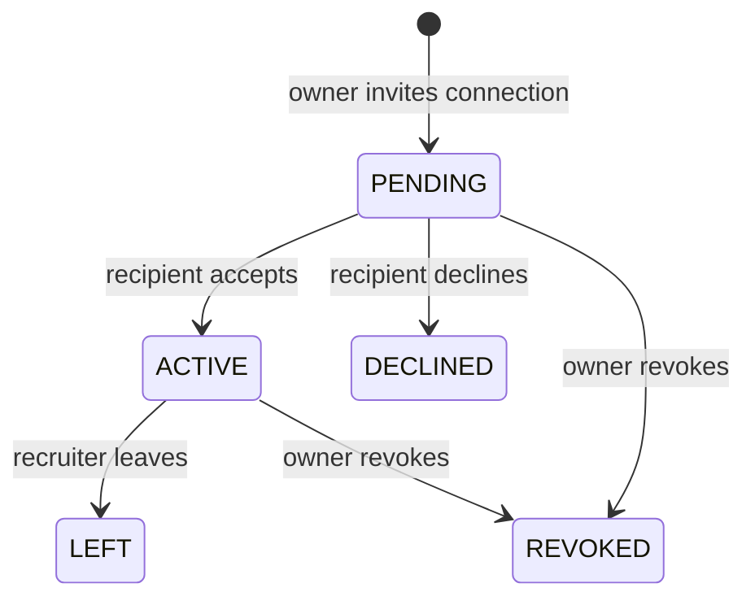

# Delegated recruiting access

This slice extends the existing organization, job and application modules in the Spring deployment. PostgreSQL remains authoritative. UI uses generated OpenAPI types and authenticated, CSRF-protected APIs.

| Requirement | Frontend | Backend / data | Verification |
|---|---|---|---|
| INT-RECRUIT-001 Invite accepted colleague | Company tools → Manage recruiters | Invitation PUT; V25 grant and audit | Authorization/idempotency tests; browser |
| INT-RECRUIT-002 Accept, decline, leave | Recruiter access | Versioned action PUT | State/uniqueness tests; browser acceptance |
| INT-RECRUIT-003 Manage jobs/review applications | Job editor and tracker | Current grant authorization | Backend and three-user browser |
| INT-RECRUIT-004 Revoke permissions | Owner team list | Owner-only revoke | Subsequent reads/writes denied; browser queue clears |

Source: required authorized recruiter actions and organization roles. Accepted-connection invitations, capacity and fixed role are recommended implementation details. This implements one recruiter role, not general organization RBAC.

## Contracts and rules

- GET /recruiter-access lists caller invitations/access, or the owner-only team when organization is supplied. Twenty UUID-ordered items, cursor and no-store.
- PUT /organizations/{organizationId}/recruiter-invitations/{id} requires owner, accepted unblocked connection, CSRF and client UUID. Exact UUID/company/connection retries return the stored grant. A partial unique index prevents duplicate pending/active grants. Maximum fifty pending/active grants per company.
- PUT /recruiter-access/{id} requires CSRF and expected version. Recipient accepts/declines pending access or leaves active access; owner revokes either. Terminal grants cannot reactivate; a new invitation is required.
- Active recruiters manage all company jobs and read/review all company applications. They cannot edit company details or grant roles. Applicants cannot review their own application even if later granted recruiting access. Owner/recruiter cannot submit a new application to their company.
- Organization.canRecruit and Job.canManage express recruiting permissions; owned continues to mean ownership.
- Application history records RECRUITER separately from COMPANY_OWNER and APPLICANT, without identity-provider subjects.
- Application forms disclose sharing with owner and authorized recruiters. Removing a connection or blocking does not revoke an accepted company role; the owner must explicitly revoke.
- Previously viewed data cannot be remotely erased. Received applications re-fetch on content-free real-time hints and the existing polling fallback.

## Transactions and recovery

Role changes lock the organization row. Job publishing, application submission and review take that same lock before rechecking authorization and modifying records. This orders revocation against writes without a distributed transaction. A write committed before revocation may succeed; a later write cannot rely on a stale active grant. Reads authorize from current database grants. Audit and business changes commit together.

Real-time refresh hints include owner, applicant and current active recruiters after commit. Role changes notify owner and recipient. Hints are lossy, content-free and single-instance; durable role/application notifications remain backlog. Client requests have ten-second deadlines. Ambiguous writes require refresh before retry; invitation UUID is retained for replay. Success requires an API confirmation.

## Validation and remaining scope

Targeted PostgreSQL integration test and real Keycloak/PostgreSQL browser journey passed. Browser coverage includes invitation, acceptance, job editing, private application review, revocation, live removal of the review queue and denied history access. Desktop axe and 390px overflow checks passed; desktop/mobile light screenshots reviewed. Full regression outcome is recorded in README after execution.

Resume uploads, configurable application questions, finer-grained company roles, ownership transfer, durable notifications, audit export, comprehensive concurrent-revocation stress testing and cloud deployment remain pending. This is not a production-readiness claim.
