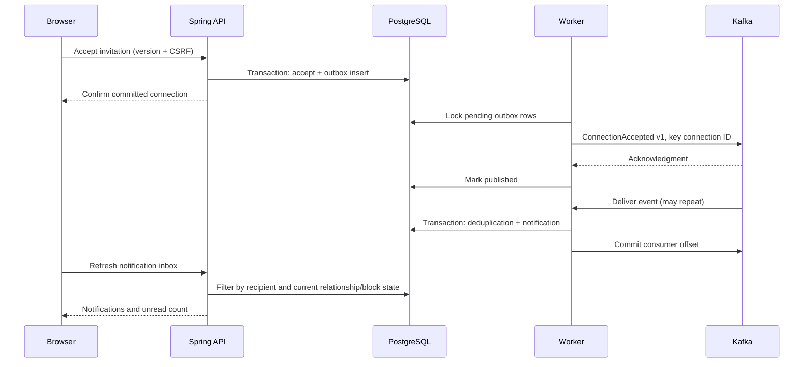

# Connection/application notifications and event delivery

This slice runs inside the existing modular Spring application. PostgreSQL owns connection state, the outbox, consumer deduplication and notifications. Kafka is an internal transport; browsers use authenticated REST through the existing BFF.

## Contracts and guarantees

- REST: `packages/contracts/profile.openapi.yaml`; generated browser types: `apps/web/app/api-schema.d.ts`.
- Event: `packages/contracts/events/connection-accepted.v1.schema.json`. Only event ID, schema version, type and connection ID are published. No credentials, OTPs or message bodies.
- Topics: `meridian.connections.v1` and `meridian.connections.v1.dlq`; group `meridian-notifications-v1`. Local topics have one partition, one replica and seven-day retention.
- Source transaction records the outbox atomically with acceptance. Publishing is at least once; a crash after broker acknowledgment can cause republication. Consumer deduplication and notification insertion share a database transaction. No exactly-once claim across Kafka/PostgreSQL.
- Relay batches up to 20 rows with SKIP LOCKED. Failed publication retains the record and schedules exponential backoff capped at 300 seconds plus jitter. Consumer failures retain the unacknowledged offset for retry. Invalid envelopes go to the DLQ before acknowledgment.
- Read-your-writes applies to accepted connections and read/preference updates. Notification arrival is eventual. Preferences are evaluated at projection time, not event creation time.
- Notification IDs belong to the invitation sender; only that member can read or mark them. Removed connections and blocks suppress the inbox entry and unread count. Preference updates use optimistic version checks.
- Read marking is idempotent. The inbox supports connection and application notifications, category filters and lossy WebSocket hints backed by polling. Other notification types/channels remain planned.

## Local operation

`./scripts/container-up.sh --profile observability` builds the applications and starts Kafka with the other dependencies. Host development via `./scripts/dev.sh` enables the events profile. The host broker listens only on 127.0.0.1:19092 (override KAFKA_PORT); application containers use kafka:9092. Host backend override: KAFKA_BOOTSTRAP. EVENTS_ENABLED=false disables the worker, but acceptance still records pending events.

Kafka 4.1.2 follows the [Apache Docker guide](https://kafka.apache.org/41/getting-started/docker/). The worker uses the Java client directly; there is no Spring Kafka retry-topic mechanism.

A broker outage after startup delays delivery without preventing acceptance. Startup currently requires Kafka for topic initialization. Database failure prevents acceptance and projection. Application readiness checks PostgreSQL, not event delivery latency.

Metrics include meridian.outbox.pending, meridian.outbox.published, meridian.outbox.retries, meridian.events.failures and meridian.events.quarantined. Check the pending gauge, retry rate, broker health and notification delay together. The metric names are converted to Prometheus conventions on export. Dedicated event alerts and lag dashboards remain pending.

For a growing backlog, first restore broker/database availability; do not delete outbox rows. For quarantine, inspect the schema mismatch in a controlled environment, fix the producer/consumer, and validate a corrected envelope before an operator republishes it with the same event ID. There is no automated DLQ replay command. Offsets may be replayed without duplicate notification rows while processed_event is retained; a full projection rebuild requires coordinated deduplication/state handling and is not implemented.

## Verification and remaining work

EventIntegrationTest uses real PostgreSQL and Kafka containers, with injected authenticated principals for API checks. It covers acceptance/outbox delivery, repeated events, invalid envelope quarantine, recipient/CSRF authorization, read idempotency, preference conflicts/suppression and a failed broker publish followed by recovery. Browser verification uses real Keycloak, the running backend, PostgreSQL and Kafka, with local Mailpit replacing external email delivery.

Local plaintext Kafka is development-only. Production needs broker ACLs/TLS, replication and capacity planning, topic provisioning outside app startup, retention/cleanup policies for database event records, consumer lag alerts, tracing/correlation metadata and prolonged failure/load drills. The single scheduled worker couples relay and consumer throughput; its batch timing must be bounded before scaling. No production deployment or throughput target is claimed.

## Slice traceability

All rows below are explicitly required by the unified prompt; local single-broker topology is a recommended development detail.

| Requirement | Frontend | Backend/data | Contract | Evidence | Status |
|---|---|---|---|---|---|
| INT-NOTIFY-001 Connection acceptance delivery | /notifications | NetworkController, V16 outbox, EventWorker, NotificationProjector | ConnectionAccepted v1 | EventIntegrationTest; visibility.spec.ts | Integration verified; results in README |
| BE-EVENT-001 At-least-once delivery and deduplication | N/A | outbox + processed_event transactions | Kafka schema | Replay, quarantine and broker failure test | Integration verified |
| FE-NOTIFY-001 Inbox and unread state | notification cards, pagination, refresh | NotificationController recipient filtering | GET notifications; PUT read | Browser read persistence; API authorization | Integration verified; results in README |
| INT-NOTIFY-002 Connection preference | persisted checkbox | versioned notification_preference | GET/PUT preferences | Browser reload; CAS and suppression tests | Integration verified; results in README |
| BE-NOTIFY-003 Current privacy enforcement | backend-filtered list | connection state and block checks | NotificationPage | Removed-connection suppression test | Integration verified |
| INT-NOTIFY-004 Live updates and other categories | Pending | Pending | Pending | Not verified | Planned |

## Application event operations (V27)

The same worker/group now handles meridian.applications.v1 and meridian.applications.v1.dlq with the same local partition/replica/retention settings. ApplicationChanged v1 uses application ID as partition key and carries only identifiers/version. Outbox rows link to immutable audit versions, and later versions wait for earlier unpublished rows. Shared backlog/retry/failure/quarantine metrics include both event types. Kafka outage tests exercise the shared relay; prolonged application-specific restart/failover drills remain pending.

Application quarantine records are redacted diagnostics (sourceTopic, partition, offset, error), not replayable event payloads. Use the restricted canonical outbox/audit to construct a corrected schema-valid envelope with its original event ID; do not blindly republish the DLQ diagnostic or copy private application content into a broker message. Source records predating V27 are not backfilled. A valid envelope without a matching canonical outbox/audit is ignored. Preference-suppressed events are marked processed and do not backfill on opt-in.

Application source/audit rows are referenced by outbox and notification records; any future deletion/retention workflow must coordinate these references. Do not delete processed_event records as a routine recovery step. Notification historical status may differ from current application state; inspect the application tracker for current status. See ../notifications-slice.md for recipients, authorization and filter semantics.
